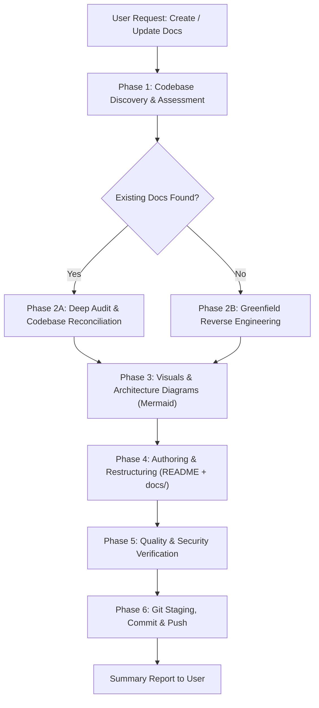

# Autonomous Documentation Engineer (`auto-docs`)

This skill governs the end-to-end lifecycle of repository documentation: discovering code structure, auditing existing docs or authoring from scratch, generating rich Mermaid visual diagrams, validating references, and safely committing and pushing documentation updates to Git.

---

## ⚡ Quick Reference Workflow



---

## Phase 1: Codebase Discovery & Assessment

1. **Inspect Repository Metadata**:
   - Detect primary language and frameworks by inspecting manifest files:
     - Python: `pyproject.toml`, `requirements.txt`, `setup.py`, `Pipfile`
     - JavaScript/TypeScript: `package.json`, `tsconfig.json`, `pnpm-lock.yaml`, `yarn.lock`
     - Go: `go.mod`
     - Rust: `Cargo.toml`
     - Java/Kotlin: `pom.xml`, `build.gradle`
     - Infrastructure: `Dockerfile`, `docker-compose.yml`, `.github/workflows/`, `Makefile`
2. **Generate Repository File Tree**:
   - Run the helper script to view directory structure:
     ```bash
     python3 ~/.gemini/config/skills/auto-docs/scripts/generate_tree.py . 3
     ```
3. **Assess Existing Documentation**:
   - Search for existing doc files:
     - `README.md`, `README.rst`, `README.txt`
     - `docs/` directory
     - `CONTRIBUTING.md`, `ARCHITECTURE.md`, `CHANGELOG.md`
     - OpenAPI/Swagger specs, Postman collections
   - Determine execution branch:
     - If substantial documentation exists ➔ Proceed to **Phase 2A (Audit & Refresh)**.
     - If documentation is missing, trivial, or placeholder ➔ Proceed to **Phase 2B (Greenfield Creation)**.

---

## Phase 2A: Deep Audit & Codebase Reconciliation

*Consult the audit checklist: [references/doc-audit-checklist.md](./references/doc-audit-checklist.md)*

1. **Verify File References**:
   - Cross-reference all file paths, scripts, and imports mentioned in docs against the actual filesystem. Fix or remove broken references.
2. **Reconcile CLI & API Contracts**:
   - Inspect CLI argument parsers (`argparse`, `click`, `commander`, etc.) and route definitions. Ensure documented flags, arguments, default values, and endpoints match the current code exactly.
3. **Audit Environment & Configuration**:
   - Search the codebase for environment variable lookups (`os.getenv`, `process.env`, `config.get`).
   - Ensure all active variables are documented in a clean Markdown table with types and defaults.
4. **Purge Outdated/Dead Content**:
   - Remove references to deleted modules, deprecated arguments, obsolete dependencies, or historical dead ends.
   - Retain intentional business and domain context while rewriting confusing or outdated explanations.

---

## Phase 2B: Greenfield Reverse Engineering

1. **Identify Entry Points & Core Flow**:
   - Trace application lifecycle from entry files (e.g. `main.py`, `index.ts`, `server.py`, `cli.py`, `cmd/main.go`).
   - Identify critical service classes, database interfaces, external API calls, and event workers.
2. **Extract Operational Requirements**:
   - Determine required runtime versions, database engines, external service credentials, and build prerequisites.
3. **Formulate Value Proposition**:
   - Write a clear 1-2 sentence description answering: *What problem does this project solve? How does it work? Who is it for?*

---

## Phase 3: Visuals & Architecture Diagrams (Mermaid)

*Consult templates: [references/diagram-templates.md](./references/diagram-templates.md)*

Every production repository documentation MUST include visual diagrams. Use standard GitHub-compatible Mermaid blocks:

1. **System Architecture Diagram** (`flowchart TD` or `flowchart LR`):
   - Illustrate boundaries: Clients / Ingress ➔ Application Layer / Services ➔ Persistence / Third-Party Services.
   - Group related components with `subgraph`.
2. **Core Workflow / Sequence Diagram** (`sequenceDiagram`):
   - Diagram the primary request/response cycle, data processing pipeline, or authentication workflow.
3. **Data Model / Entity Relationship** (`erDiagram`, if database present):
   - Map key tables/entities, relationships (`1-N`, `N-N`), and primary fields.
4. **State Machine / Flowchart** (`stateDiagram-v2` or `flowchart LR`, if lifecycle exists):
   - Map order, task, or pipeline status transitions.

> [!IMPORTANT]
> Always quote Mermaid node labels containing parentheses, dashes, or colons (e.g., `NodeA["Parser (v2)"]`) to prevent syntax rendering errors.

---

## Phase 4: Authoring & Restructuring

*Consult standard layout: [references/readme-template.md](./references/readme-template.md)*

1. **Structure `README.md`**:
   - **Header & Badges**: Clean project title, high-level summary, status badges.
   - **Table of Contents**: Hyperlinked sections for fast navigation.
   - **Key Features**: Concise bullet points explaining capabilities.
   - **Architecture & Diagrams**: The Mermaid diagrams crafted in Phase 3.
   - **Project Structure**: ASCII directory tree with annotations.
   - **Prerequisites**: Clear runtime and tool prerequisites.
   - **Quick Start**: Exact, copy-pasteable installation and run commands.
   - **Configuration**: Complete table of environment variables and configuration files.
   - **Usage Examples**: Realistic CLI commands and code snippets.
   - **API / Module Reference**: Core functions, classes, or HTTP routes.
   - **Testing & Development**: Commands to run test suites, linting, and formatting.
   - **Deployment**: Docker, cloud, or background process setup.
   - **Contributing & License**.
2. **Modularize Large Projects**:
   - If the repository has complex sub-systems, split in-depth documentation into `docs/`:
     - `docs/ARCHITECTURE.md`: Deep component internals and decision rationale.
     - `docs/API.md`: Detailed endpoint schemas, request/response JSON.
     - `CONTRIBUTING.md`: Developer guidelines, setup, and PR conventions.

---

## Phase 5: Quality & Security Verification

1. **Verify Relative Markdown Links**:
   - Check that every internal anchor and relative path (e.g. `[ARCHITECTURE](./docs/ARCHITECTURE.md)`) points to a valid target.
2. **Prevent Credential Leaks**:
   - **CRITICAL**: Never include real API keys, secrets, tokens, passwords, or live internal production URLs in documentation. Always use obvious placeholders (e.g., `sk-proj-your-api-key-here`, `<DATABASE_URL>`).
3. **Verify Shell Commands**:
   - Ensure documented commands match real scripts and tools in the repository.

---

## Phase 6: Git Staging, Commit & Push

1. **Check Git Status**:
   ```bash
   git status
   ```
2. **Stage Documentation Files Only**:
   - Stage created or updated documentation files explicitly:
     ```bash
     git add README.md docs/ CONTRIBUTING.md
     ```
   - **DO NOT** use `git add .` or `git add -A` to avoid accidentally staging credentials, `.env`, or build artifacts.
3. **Craft Conventional Commit**:
   - Create a clean, descriptive commit message:
     ```bash
     git commit -m "docs: generate comprehensive repository documentation and architecture diagrams"
     # or if updating:
     git commit -m "docs: refresh and audit documentation against current codebase"
     ```
4. **Push to Remote**:
   - Detect current branch:
     ```bash
     BRANCH=$(git branch --show-current)
     ```
   - Push changes:
     ```bash
     git push origin "$BRANCH"
     ```
   - If the upstream tracking branch is not yet configured:
     ```bash
     git push -u origin "$BRANCH"
     ```
5. **Present Completion Report**:
   - Summarize the updated/created files.
   - Display a preview or description of the diagrams added.
   - Provide the commit hash and remote push confirmation.
