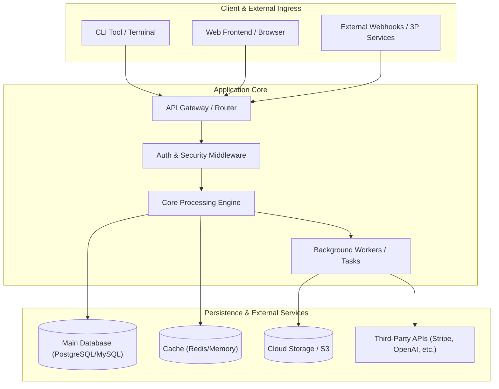
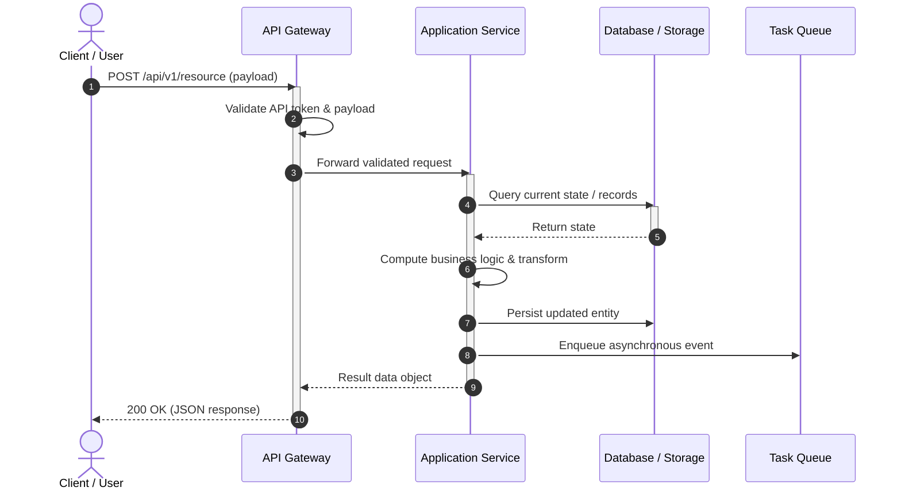
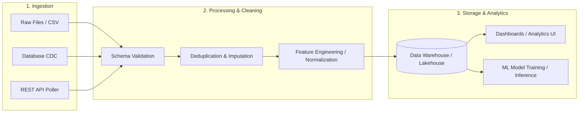
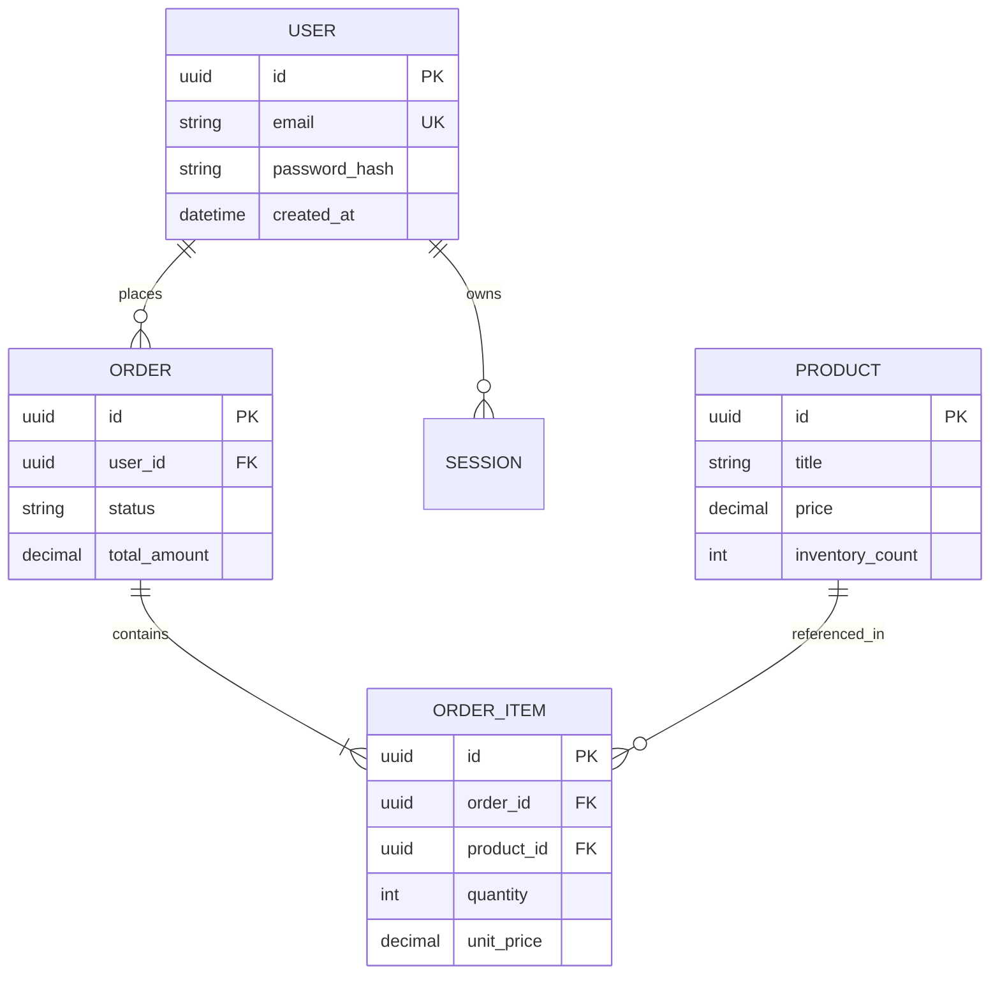
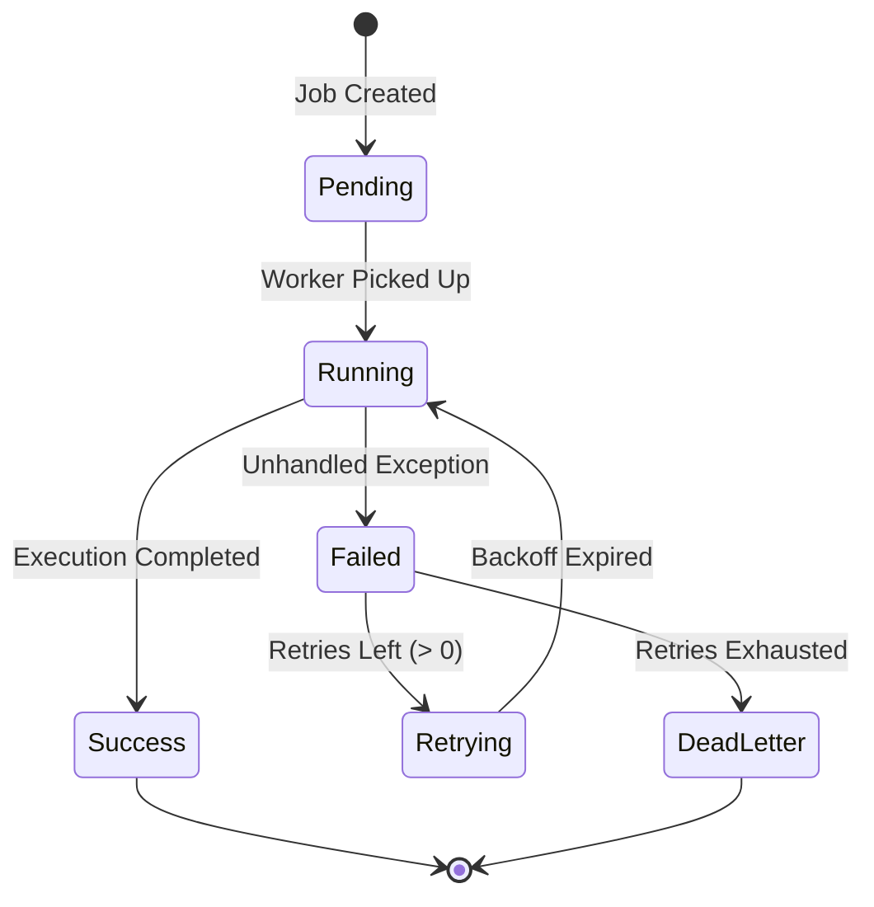

# Mermaid Diagram Templates for Documentation

This reference provides production-ready Mermaid diagram templates designed for software repository documentation. GitHub and GitLab render Mermaid natively in Markdown code blocks.

---

## 1. High-Level Architecture (Flowchart TD / LR)

Used in `README.md` and `docs/ARCHITECTURE.md` to represent system components, APIs, services, and databases.

---

## 2. Request & Execution Sequence Flow (sequenceDiagram)

Ideal for explaining authentication, request processing, or algorithmic pipelines.

---

## 3. Data Ingestion & ETL Pipeline (Flowchart LR)

Useful for data analysis, machine learning, scrapers, and data pipelines.

---

## 4. Entity-Relationship Data Model (erDiagram)

For repositories with relational models, ORMs (Prisma, SQLAlchemy, TypeORM, Django), or SQL migrations.

---

## 5. State Machine / Lifecycle Diagram (stateDiagram-v2)

For tasks, orders, pipeline runs, or agents with explicit states.

---

## Syntax Rules & Anti-Patterns to Avoid

1. **Quote Node Labels**: Always wrap labels containing parentheses, hyphens, brackets, or colons in double quotes:
   - ✅ `NodeA["Process (Thread 1)"]`
   - ❌ `NodeA[Process (Thread 1)]` (causes syntax parse error).
2. **Avoid Raw HTML**: GitHub sanitizes markdown and raw HTML tags inside Mermaid can break rendering. Use standard markdown formatting.
3. **Keep Diagrams Readable**: If a system has >15 components, divide into multiple focused diagrams (e.g., High-Level Overview vs. Ingestion Flow) rather than one unreadable monolith.
