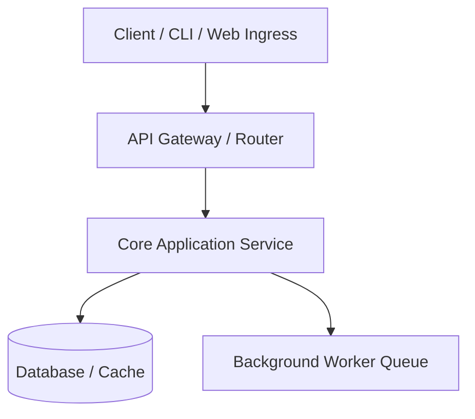

# Production README.md Template

Use this template as the standard blueprint when authoring repository documentation. Adapt sections to fit the specific project type (web app, CLI, library, microservice, data pipeline).

---

```markdown
# <Project Name>

<One to two sentence clear, compelling summary of what the project does, who it is for, and the primary problem it solves.>

[](https://opensource.org/licenses/MIT)
[]()
[]()

---

## 📑 Table of Contents

- [Features](#-features)
- [System Architecture](#-system-architecture)
- [Project Structure](#-project-structure)
- [Prerequisites](#-prerequisites)
- [Quick Start](#-quick-start)
- [Configuration & Environment](#-configuration--environment)
- [Usage & Examples](#-usage--examples)
- [API / CLI Reference](#-api--cli-reference)
- [Testing & Quality Checks](#-testing--quality-checks)
- [Deployment](#-deployment)
- [Contributing](#-contributing)
- [License](#-license)

---

## ✨ Features

- **Core Capability 1**: Concise explanation of the capability and its benefit.
- **Core Capability 2**: Concise explanation of the capability and its benefit.
- **Robust Error Handling**: Automatic retries, graceful degradation, and actionable error logs.
- **Modern Architecture**: Clean separation of concerns with modular interfaces.

---

## 🏛 System Architecture



For an in-depth architectural breakdown, see [docs/ARCHITECTURE.md](./docs/ARCHITECTURE.md).

---

## 📂 Project Structure

```text
my-project/
├── src/                  # Application source code
│   ├── api/              # Route handlers and API controllers
│   ├── core/             # Business logic and domain entities
│   ├── db/               # Database models, migrations, and clients
│   └── utils/            # Shared utilities and helpers
├── docs/                 # Extended documentation and guides
├── tests/                # Automated unit, integration, and e2e tests
├── scripts/              # Build, maintenance, and deployment scripts
├── .env.example          # Sample environment variables
├── Dockerfile            # Container definition
├── pyproject.toml        # Dependency and build configuration
└── README.md             # Project documentation entry point
```

---

## 📋 Prerequisites

Before running the project, ensure you have the following installed:

- **Runtime / Language**: e.g., Python `>= 3.11` / Node.js `>= 20.0` / Go `>= 1.22`
- **Package Manager**: e.g., `uv`, `poetry`, `pnpm`, or `npm`
- **Databases / Services**: e.g., Docker, PostgreSQL 15+, Redis (optional)

---

## 🚀 Quick Start

### 1. Clone the repository

```bash
git clone https://github.com/<owner>/<repo>.git
cd <repo>
```

### 2. Set up environment

```bash
cp .env.example .env
# Edit .env with your local credentials and keys
```

### 3. Install dependencies

```bash
# Example for Python / Node / Go:
pip install -r requirements.txt
# or: npm install
```

### 4. Run the application

```bash
# Example:
python -m src.main
# or: npm start / npm run dev
```

---

## ⚙️ Configuration & Environment

The application is configured via environment variables. Copy `.env.example` to `.env` and fill in:

| Variable | Description | Type | Default | Required |
| :--- | :--- | :--- | :--- | :--- |
| `APP_PORT` | Port number the service listens on | integer | `8080` | No |
| `DATABASE_URL` | Connection string for database | string | `sqlite:///app.db` | Yes |
| `API_SECRET_KEY` | Secret token used for signing sessions | string | - | Yes |
| `LOG_LEVEL` | Logging verbosity (`DEBUG`, `INFO`, `WARN`) | string | `INFO` | No |

> [!WARNING]
> Never commit actual credentials, private tokens, or production passwords to version control.

---

## 💡 Usage & Examples

### Basic Example

```bash
# Run command line tool
python -m src.cli --input ./data/source.csv --output ./data/result.json
```

### Code Integration Example

```python
from my_package import Client

client = Client(api_key="your-api-key")
result = client.process_item(item_id="12345")
print(result)
```

---

## 📖 API / CLI Reference

### Key CLI Commands

- `start`: Launches the background worker daemon.
- `sync`: Synchronizes local caches with remote storage.
- `healthcheck`: Performs diagnostic checks on connected services.

### Core Endpoints

| Method | Endpoint | Description | Auth Required |
| :--- | :--- | :--- | :--- |
| `GET` | `/health` | Liveness & readiness probe | No |
| `POST` | `/api/v1/jobs` | Enqueue a new asynchronous job | Bearer Token |
| `GET` | `/api/v1/jobs/:id` | Fetch job status and outputs | Bearer Token |

---

## 🧪 Testing & Quality Checks

Run test suites and style linters:

```bash
# Run unit tests
pytest tests/ -v

# Run linting and code formatting checks
ruff check .
ruff format --check .
```

---

## 📦 Deployment

### Docker Deployment

```bash
# Build container image
docker build -t my-app:latest .

# Run container
docker run -d -p 8080:8080 --env-file .env my-app:latest
```

---

## 🤝 Contributing

Contributions are welcome! Please follow these steps:

1. Fork the repository and create your feature branch (`git checkout -b feature/my-feature`).
2. Run test suites and ensure code quality passes.
3. Commit your changes using conventional commit messages.
4. Push to your branch and open a Pull Request.

---

## 📄 License

This project is licensed under the terms of the MIT License. See [LICENSE](./LICENSE) for details.
```
