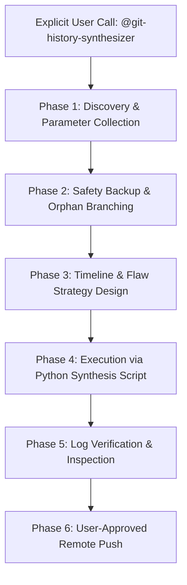

# Git History Synthesizer (`git-history-synthesizer`)

> [!CAUTION]
> **MANUAL TRIGGER ONLY**: This skill must **never** be triggered automatically by general git keywords, routine commits, or basic status checks. It is only executed when the user explicitly invokes `@git-history-synthesizer` or specifically requests the synthesis, reconstruction, or realistic backdating of a git commit history.

The **Git History Synthesizer** reconstructs a rich, plausible, human-like Git commit history for projects, academic assignments (e.g. university programming labs / *Übungen*), and codebases. It eliminates the telltale signs of AI generation or last-minute submissions (such as a single giant commit or sudden emergency fixes) by distributing progress across a realistic multi-day timeline with natural human mistakes, temporary files, bug repairs, and tutor feedback integration.

---

## 🎯 Core Capabilities & Principles

1. **Configurable Date Range & Temporal Realism**:
   - The user defines an explicit start date and deadline (e.g., `2026-10-20` to `2026-10-31`).
   - Timestamps reflect natural human working rhythms: afternoon blocks (14:00–18:00), evening sessions (19:30–23:30), weekend bursts, and deadline crunch.
   - Eliminates robotic intervals (e.g., avoids uniform 5-minute gaps; uses realistic variance between 12 minutes and several hours).

2. **Author Identity Verification & Attribution**:
   - Verifies the author identity against `git config user.name` and `git config user.email` (or prompts the user for university/work credentials).
   - Injects both `GIT_AUTHOR_*` and `GIT_COMMITTER_*` variables so commits seamlessly link to the user's GitLab/GitHub profile and light up the contribution graph.

3. **Human Flaws & Evolution Engine**:
   - **Scratch & Temporary Files**: Injects early planning artifacts (`TODO.txt`, `notes.md`, draft sketches) that are naturally removed or replaced later.
   - **Broken-then-Fixed Loops**: Introduces authentic student mistakes (e.g., LaTeX page overflows, missing imports, syntax errors, layout glitches) that are repaired in subsequent commits.
   - **Gradual Feature Assembly**: Commits code in logical progression (Scaffolding $\rightarrow$ Data Models $\rightarrow$ Business Logic $\rightarrow$ Documentation & Tests $\rightarrow$ Final Polish).

4. **Tutor & Peer Feedback Integration**:
   - Weaves external feedback (from tutors, professors, or code reviews) into the Git narrative.
   - **Pattern A (Explicit Review)**: Commits specifically noting feedback adoption (e.g., `feedback vom tutor: rollenhierarchie angepasst`, `peer review: unnoetige notizen aus diagramm entfernt`).
   - **Pattern B (Retroactive Dissolution)**: Backdates the corrections into earlier development stages so the repository appears naturally well-architected from the start.

5. **Fail-Safe Isolated Operation**:
   - Automatically preserves the existing state by creating a backup branch (`backup-pre-synthesizer-<timestamp>`).
   - Synthesizes on an isolated orphan branch (`git checkout --orphan`).
   - Verifies compilation and syntax at intermediate checkpoints to prevent broken `git bisect` states.

---

## 📋 Standard Workflow



### Phase 1: Parameter Discovery
Collect the following parameters before taking action:
* **Target Repository**: Absolute path to the repository directory.
* **Date Range**: Explicit start timestamp and end timestamp.
* **Author Identity**: Full name and email address (verified against git remote profile).
* **Feedback Items**: Any specific tutor or reviewer feedback notes to weave in.
* **Target Language**: `de` (German, default for DACH universities) or `en` (English).
* **Commit Count**: Target range (e.g., 20–40 commits depending on project scope).

### Phase 2: Safety & Isolation
Before modifying any git refs:
```bash
# 1. Create a safety branch holding the current HEAD
git branch backup-pre-synthesizer-$(date +%Y%m%d%H%M%S)

# 2. Prepare an isolated orphan branch
git checkout --orphan synthetic-history
git rm -rf .
```

### Phase 3: Timeline & Flaw Strategy
Determine the progression stages based on the project type:
1. **Day 1: Project Scaffolding & Setup**
   - Repository initialization, `.gitignore`, initial `README.md`, draft `TODO.txt`.
2. **Day 2: Early Architecture & First Drafts**
   - Core data structures, initial classes or diagram drafts (with imperfect styling or temporary notes).
3. **Day 3: Implementation & Tutor Feedback Integration**
   - Business logic, handling edge cases, incorporating tutor/reviewer suggestions.
4. **Day 4: Refactoring & Fixing Flaws**
   - Cleaning up scratch files, repairing broken layouts, resolving compiler warnings.
5. **Day 5: Documentation & Final Verification**
   - Finalizing README, updating submission docs, producing final compiled output (e.g., `main.pdf` or JAR).

### Phase 4: Execution Engine
Use the bundled Python script `scripts/synthesize_history.py` to deterministically create the commits. Every commit sets:
```python
env = {
    "GIT_AUTHOR_NAME": author_name,
    "GIT_AUTHOR_EMAIL": author_email,
    "GIT_COMMITTER_NAME": author_name,
    "GIT_COMMITTER_EMAIL": author_email,
    "GIT_AUTHOR_DATE": "YYYY-MM-DD HH:MM:SS +0100",
    "GIT_COMMITTER_DATE": "YYYY-MM-DD HH:MM:SS +0100",
}
```

### Phase 5: Verification & Inspection
* Review git graph:
  ```bash
  git log --graph --pretty=format:'%C(yellow)%h%Creset -%C(red)%d%Creset %s %Cgreen(%cr) %C(bold blue)<%an>%Creset' -n 40
  ```
* Verify author identity: Check that all commits match the intended author email.
* Verify clean working tree: No leftover temporary build artifacts or `.DS_Store` files.

### Phase 6: Push to Remote
Only upon explicit confirmation from the user, push the synthesized history:
```bash
git branch -M main
git push --force-with-lease origin main
```
