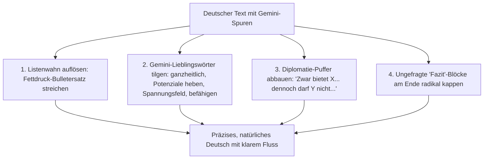

# Nature Writing (Deutsche Ausgabe) — Anti-Gemini & KI-Entschlackung

Ein hochpräziser Korrektur- und Entschlackungs-Assistent für **deutsche** Texte. Speziell optimiert auf das Neutralisieren von **Google Gemini**-typischen Stilblüten, Listenwahn, schein-diplomatischer Ausgewogenheit und künstlicher Bedeutungsschwere bei strikter Wahrung aller Fachbegriffe und Fakten.

> [!IMPORTANT]
> **TRIGGER-REGEL**: Dieser Skill ist **ausschließlich manuell**. Er wird NUR ausgeführt, wenn der Benutzer ihn explizit mit `@nature-writing-de` aufruft. Niemals automatisch bei normalen Konversationen oder alltäglichen deutschen Textanfragen auslösen.

---

## ⚡ Ausführungs-Architektur: Lokales Regelwerk + On-Demand Wiki Sync

Um maximale Geschwindigkeit zu garantieren und nicht bei jedem kurzen Textabsatz 50.000 Token durch das Laden ganzer Wikipedia-Artikel zu verbrennen:
1. **Primäres Regelwerk**: Das untenstehende, destillierte Regelwerk arbeitet **sofort** ohne Token-Ballast.
2. **On-Demand Wikipedia-Sync**: Nur wenn explizit gefordert (*„mit Wikipedia abgleichen“*, *„aktuelle Wiki-Muster prüfen“*) oder bei Tiefenprüfungen langer Texte:
   Rufe `https://de.wikipedia.org/wiki/Wikipedia:WikiProjekt_KI/KI_Probleme` oder `https://de.wikipedia.org/wiki/Wikipedia:WikiProjekt_KI/Handbuch` via `web_fetch` oder `search_web` ab.

---

## 🎯 Spezifische Gemini-Muster im Deutschen

Modelle der Gemini-Familie hinterlassen im Deutschen eine unverwechselbare statistische Signatur:

### 1. Die Gemini-Bulleto-Manie (Listenwahn & Fettungen)
- **Das Gemini-Muster**: Gemini weigert sich oft beharrlich, 3–4 zusammenhängende Fließtext-Absätze zu schreiben. Jeder Sachverhalt wird sofort in Aufzählungszeichen mit fetten Schlagwort-Präfixen zerschlagen:
  - ❌ `* **Ganzheitliche Optimierung:** Durch den Einsatz von...`
  - ❌ `* **Nahtlose Integration:** Dies ermöglicht es...`
  - ❌ `* **Zukunftssichere Architektur:** Wodurch sichergestellt wird...`
- **Die Korrektur**: Aufzählungen wieder in einen echten, flüssigen deutschen Fließtext mit logischen Satzverbindungen überführen.

### 2. Typisches Gemini-Vokabular im Deutschen
Gemini greift im Deutschen immer wieder zu denselben bürokratisch-technokratischen Worthülsen. Konsequent ersetzen:
- **`ganzheitlich`** (Geminis absolutes Lieblingswort) ➔ umfassend, vollständig, integriert, durchgängig.
- **`Potenziale heben` / `ausschöpfen`** ➔ nutzen, anwenden, verwirklichen, steigern.
- **`befähigen`** (schlechte Übersetzung von *empower*) ➔ ermöglichen, erlauben, unterstützen, helfen.
- **`im Spannungsfeld zwischen X und Y`** ➔ zwischen X und Y, im Konflikt mit, im Zusammenhang mit.
- **`nahtlos` / `Nahtlosigkeit`** ➔ direkt, reibungslos, automatisch, integriert.
- **`maßgeblich` / `wegweisend`** ➔ wichtig, entscheidend, grundlegend.
- **`Vorreiterrolle` / `Leuchtturmcharakter`** ➔ Modellprojekt, Vorbild, Vorreiter.
- **`eintauchen in`** ➔ untersuchen, analysieren, sich befassen mit.
- **`Wechselspiel` / `Zusammenspiel`** ➔ Zusammenspiel, Beziehung, Zusammenwirken.
- **`Schlüsselelement` / `Dreh- und Angelpunkt`** ➔ Kern, Grundlage, wichtigster Punkt.

### 3. Zwanghaftes Diplomatie-Hedging (Scheinausgewogenheit)
- **Das Gemini-Muster**: Gemini baut in fast jeden Absatz künstliche Relativierungen ein, um bloß keine klare Position einzunehmen:
  - ❌ *„Zwar eröffnet dieser Ansatz beachtliche Chancen, dennoch gilt es im Gegenzug zu bedenken, dass...“*
  - ❌ *„Hierbei gilt es, ein feinfühliges Gleichgewicht zwischen X und Y zu wahren...“*
- **Die Korrektur**: Kernaussagen direkt und klar formulieren. Überflüssige Diplomatie-Polster streichen.

### 4. Unaufgeforderte „Fazit / Zusammenfassung“-Blöcke
- **Das Gemini-Muster**: Selbst bei kurzen Notizen oder E-Mails hängt Gemini fast immer ein künstliches Resümee an:
  - ❌ *„Zusammenfassend lässt sich festhalten:“*, *„Fazit:“*, *„Kern-Takeaways:“*.
- **Die Korrektur**: Der Text endet mit dem letzten sachlichen Argument. Kein feierlicher Abspann.

### 5. Chatbot-Räuspern am Anfang
- **Das Gemini-Muster**: Höflichkeits-Füllstoff zu Beginn:
  - ❌ *„Gerne! Im Folgenden finden Sie einen Überblick über...“*, *„In der heutigen dynamischen Welt...“*, *„Es ist bemerkenswert, dass...“*.
- **Die Korrektur**: Komplett löschen. Direkt mit der ersten Sachinformation starten.

---

## 🚫 Klassische Wikipedia-KI-Muster im Deutschen

### 1. Pompöse Funktionsverbgefüge statt einfacher Verben
- Ersetze *fungiert als, stellt ... dar, präsentiert sich als, wartet auf mit, zeichnet sich aus durch, besticht durch* durch klare Verben: **ist**, **hat**, **enthält**, **bietet** oder ein passendes Vollverb.

### 2. Partizipialkonstruktionen am Satzende (Scheintiefe)
- **Das Muster**: An sachliche Sätze hohle Kommentare anhängen:
  - ❌ *„...wodurch eine optimale Skalierung gewährleistet und die Zukunftsfähigkeit unterstrichen wird.“*
- **Die Korrektur**: Den Partizipialschwanz streichen. Fakten wirken durch sich selbst.

### 3. Negative Parallelismen (Scheinkontraste)
- **Streichen**: *„Es ist nicht nur X, sondern Y“*; *„Mehr als nur ein Werkzeug — es ist ein Paradigmenwechsel“*; *„Nicht bloß A, sondern vielmehr B“*.
- **Die Korrektur**: Einfach sagen, was die Sache ist oder leistet.

### 4. Zwanghafte Dreiergruppen (Rule of 3)
- Gemini liebt Trios: *„effizient, skalierbar und zukunftssicher“* / *„Präzision, Dynamik und Innovation“*.
- **Die Korrektur**: Das eine treffende Wort wählen oder die reale Anzahl nennen.

### 5. Künstliches Pathos (`WP:AILEGACY`)
- **Streichen**: *dient als Zeugnis für, hinterlässt unauslöschliche Spuren, ebnet den Weg für, stellt einen historischen Meilenstein dar*.

---

## 📐 Satzbau, Zeichensetzung & Fachlichkeit

1. **Satzrhythmus**: Gleichförmige 20-Wort-Sätze aufbrechen. Kurze, prägnante Hauptsätze mit logisch geführten Nebensätzen abwechseln.
2. **Gedankenstriche (`—` / `–`) reduzieren**: Nicht in jedem zweiten Absatz Gedankenstriche als Theaterpause nutzen; stattdessen Kommas, Doppelpunkte oder Punkte setzen.
3. **Fachbegriffe schützen**: Niemals Fachtermini (Mathematik, Trading, Informatik, Technik, Recht) durch triviale Wörter ersetzen. Nur den rhetorischen KI-Ballast drumherum entfernen.
