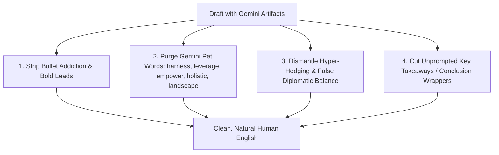

# Nature Writing (English Edition) — Anti-Gemini & AI De-Synthesizer

A precision humanization and editing engine tailored specifically to neutralize **Google Gemini's** and other modern LLMs' stylistic quirks, formatting obsessions, and synthetic writing patterns while preserving the author's facts, technical precision, and genuine voice.

> [!IMPORTANT]
> **TRIGGER RULE**: This skill is **strictly manual**. Invoke ONLY via `@nature-writing-en`. Never auto-trigger during casual conversation.

---

## ⚡ Execution Architecture: High-Efficiency Rules + Live Wiki Sync

To maximize performance and prevent blowing through tens of thousands of tokens by re-fetching Wikipedia on every small edit:
1. **Primary Rules Engine**: The local distilled rulebook below executes **instantly** with zero token bloat.
2. **On-Demand Wikipedia Sync**: When explicitly asked (*"sync with Wikipedia"*, *"check latest Wiki signs"*), or during comprehensive audits of long texts, fetch live:
   `https://en.wikipedia.org/wiki/Wikipedia:Signs_of_AI_writing` via `web_fetch` or `search_web`.

---

## 🎯 Specific Google Gemini Tells to Neutralize

Gemini models possess a distinct, highly identifiable synthetic signature:

### 1. Bullet Addiction & Mechanical Bold Headers
- **The Gemini Tell**: Gemini pathologically avoids writing 3–4 coherent paragraphs of natural prose. Given any topic, it automatically fragments the text into bullet points with bold prefixes:
  - ❌ `* **Enhanced Scalability:** By utilizing...`
  - ❌ `* **Seamless Integration:** It allows...`
  - ❌ `* **Holistic Approach:** Ensuring that...`
- **The Fix**: Rebuild these fragmented bullets into continuous, flowing narrative paragraphs with organic transitions.

### 2. The Gemini Pet Vocabulary
Gemini overuses specific corporate-technocratic terms at a statistically unnatural rate. Ruthlessly replace them:
- **`harness` / `leverage`** ➔ use, apply, run, deploy, rely on.
- **`empower`** ➔ allow, enable, let users, support.
- **`holistic` / `comprehensive`** ➔ complete, thorough, end-to-end, broad.
- **`landscape` / `ecosystem`** ➔ industry, market, field, domain, environment.
- **`nuanced`** ➔ detailed, specific, subtle, varied.
- **`seamless` / `seamlessly`** ➔ smooth, direct, automatic, without disruption.
- **`robust`** ➔ sturdy, reliable, tested, solid.
- **`delve` / `dive deep`** ➔ examine, explore, look into, analyze.
- **`testament` / `beacon` / `catalyst`** ➔ evidence, example, driver.
- **`overarching` / `game-changer` / `unlock`** ➔ main, major, release, open up.

### 3. Hyper-Balanced Diplomacy (Compulsive Hedging)
- **The Gemini Tell**: Gemini pathologically balances every assertion with a diplomatic counter-statement to avoid taking a stance:
  - ❌ *"While X offers notable advantages, it is equally essential to recognize that Y presents distinct challenges..."*
- **The Fix**: State the argument or factual finding directly. Cut the artificial diplomatic cushion.

### 4. Compulsive "Takeaway / Conclusion" Wrappers
- **The Gemini Tell**: Gemini almost always slaps a canned summary section at the bottom, even for short 2-paragraph requests:
  - ❌ *"In summary,"*, *"Key Takeaways:"*, *"The Bottom Line:"*, *"In conclusion,"*.
- **The Fix**: End immediately after the final substantive point. Let the conclusion be natural, not labeled.

### 5. Chatty "Helpful Assistant" Throat-Clearing
- **The Gemini Tell**: Conversational residue at the start of drafts:
  - ❌ *"Certainly! Here is an overview of..."*, *"Let's explore the key aspects of..."*, *"It is worth noting that..."*.
- **The Fix**: Delete entirely. Start immediately with the first factual statement.

---

## 🚫 Classical Wikipedia AI Structural Tells (`WP:Signs_of_AI_writing`)

### 1. Inflated Significance & Legacy (`WP:AILEGACY`)
- **Cut**: *stands as a testament to*, *plays a pivotal/crucial/vital role*, *underscores its importance*, *left an indelible mark*, *setting the stage for*.
- **Fix**: State what the subject did, built, or discovered without declaring it "monumental".

### 2. Superficial Participial Tails
- **Cut**: Tacking empty `-ing` clauses onto factual statements:
  - ❌ *"...ensuring optimal throughput, highlighting its efficiency, and underscoring its adaptability."*
- **Fix**: Remove the tail. Facts stand on their own without cheering.

### 3. Avoidance of Basic Copulatives (`is`, `are`, `has`)
- LLMs replace plain *is* and *has* with *serves as, stands as, marks, represents, boasts, features*.
- **Fix**: Restore simple, crisp verbs: **is**, **are**, **has**, **contains**.

### 4. Negative Parallelisms (Strawman Contrasts)
- **Cut**: *"It is not just X, it is Y"*; *"Not only X, but also Y"*; *"X rather than Y"*; *"No X, no Y, just Z"*.
- **Fix**: State directly what the entity is or does.

### 5. Break the Rule of Three (Triplet Obsession)
- LLMs compulsively group adjectives and verbs into threes (*"fast, scalable, and secure"*).
- **Fix**: Use the single most accurate adjective, a solid pair, or the exact count required.

---

## 📐 Rhythm, Punctuation & Style Guidelines

1. **Vary Sentence Length**: Break monotonous sequences of 18–22 word sentences. Mix short punchy statements (4–7 words) with compound sentences.
2. **Eliminate Em-Dash Overkill**: Replace theatrical em-dashes (`—`) used as dramatic pivots with commas, parentheses, or periods.
3. **Preserve Technical Rigor**: Never dumb down domain-specific terminology (finance, quant, software engineering, law). Strip only the rhetorical fluff around it.
