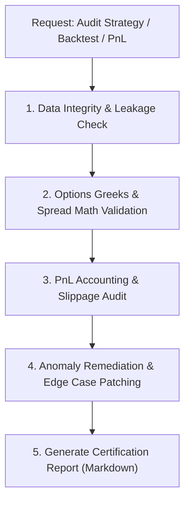

# Quantitative Options & Backtest Auditor (`quant-backtest-audit`)

This skill enforces a **Zero-Tolerance Quantitative Audit Posture** for options trading algorithms, machine learning signal generators (e.g. ML28), paper trading execution loops, and PnL accounting engines.

---

## 🔬 Core Responsibilities

1. **ML Signal & Feature Pipeline Audit**:
   - Check all feature calculations for lookahead bias (future leakage).
   - Validate numerical stability (guard against division by zero in volatility or spread ratios, zero volume).
   - Reconcile feature skew between train, backtest, and live inference.
2. **Options Mechanics & Pricing Integrity**:
   - Verify Black-Scholes or binomial pricing Greeks boundary conditions.
   - Audit credit spread construction: short strike delta compliance, spread width vs credit collected.
   - Enforce realistic execution friction (slippage, bid-ask spread crossing, broker commissions).
3. **PnL & Risk Accounting Reconciliation**:
   - Ensure intraday PnL (`day_pnl`) and lifetime PnL (`total_pnl`) are decoupled and reset accurately.
   - Check trailing stop and peak profit logic under dynamic exit management.
   - Compare backtest execution logs with actual broker statements (Exante, IBKR, paper trading ledger).
4. **Standardized Certification Reporting**:
   - Generate structured audit documents following [references/audit-report-template.md](./references/audit-report-template.md).

---

## 📋 Audit Workflow & Execution Protocol

### Phase 1: Data Integrity & Leakage Verification
- Consult [references/quant-audit-checklist.md](./references/quant-audit-checklist.md).
- Search feature generators for `.shift(-1)`, forward-looking rolling windows, or future timestamp leakage.
- Confirm that normalizers are fit exclusively on historical training subsets.

### Phase 2: Options Pricing & Spread Mathematics
- Verify credit spread delta: short leg delta must lie strictly within target boundaries (e.g. `[0.10, 0.20]`).
- Verify minimum credit collected:
  $$\text{Credit} \ge \alpha \times \text{Spread Width}$$
- Audit dynamic exit criteria: profit targets (e.g., 50% max profit), stop loss (e.g., $2 \times$ credit), and DTE (days-to-expiration) rules.

### Phase 3: PnL & Ledger Accounting
- Check the exact formula used to calculate `unrealized_pnl` and `realized_pnl`.
- Verify multi-leg close handling: all legs must close synchronously or trigger leg risk containment.

### Phase 4: Generate Certification Artifact
- Save report to `artifacts/THIRD_PARTY_AUDIT_REPORT_<N>.md` or `docs/audits/`.
- Report findings with exact line numbers, mathematical explanations, and verifiable unit test recommendations.
