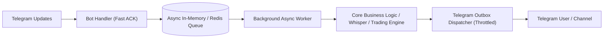

# Telegram Bot Resilience & Architecture Patterns

---

## 🏗 1. Decoupled Architecture (Bot vs Business Logic)

Never execute heavy business logic or long-running tasks directly inside Telegram update handlers:



---

## 🛡 2. Error & Exception Handling Patterns

### Handling Telegram Network & Connection Drops
```python
import asyncio
import logging
from aiogram.exceptions import TelegramNetworkError, TelegramRetryAfter

async def run_bot_with_reconnect(dp, bot):
    while True:
        try:
            logging.info("Starting bot polling...")
            await dp.start_polling(bot)
        except TelegramNetworkError as e:
            logging.warning(f"Telegram network glitch: {e}. Reconnecting in 5s...")
            await asyncio.sleep(5)
        except TelegramRetryAfter as e:
            logging.warning(f"Rate limited by Telegram. Sleeping {e.retry_after}s...")
            await asyncio.sleep(e.retry_after)
        except Exception as e:
            logging.error(f"Unexpected bot crash: {e}", exc_info=True)
            await asyncio.sleep(10)
```

---

## 🚀 3. Docker Compose & Systemd Supervision

### Docker Compose Service Definition
```yaml
services:
  telegram_bot:
    build: .
    restart: unless-stopped
    environment:
      - BOT_TOKEN=${BOT_TOKEN}
      - PYTHONUNBUFFERED=1
    logging:
      driver: "json-file"
      options:
        max-size: "10m"
        max-file: "3"
```
