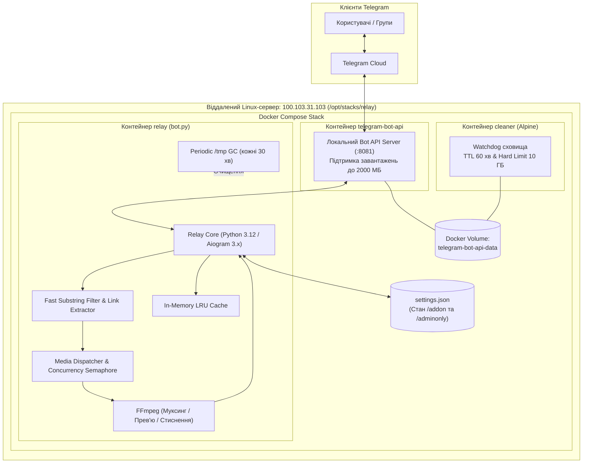
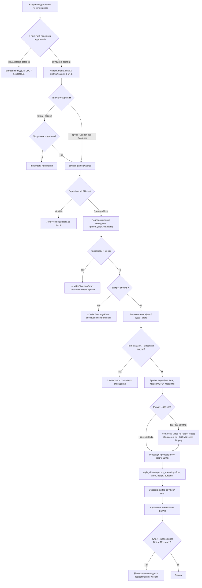
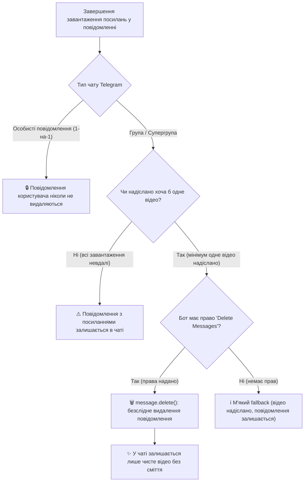
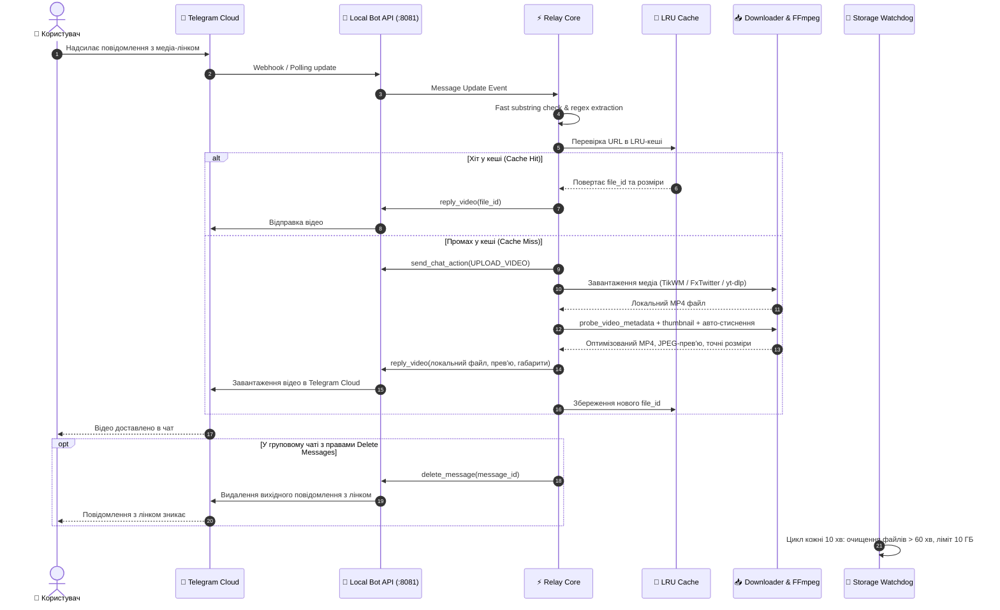
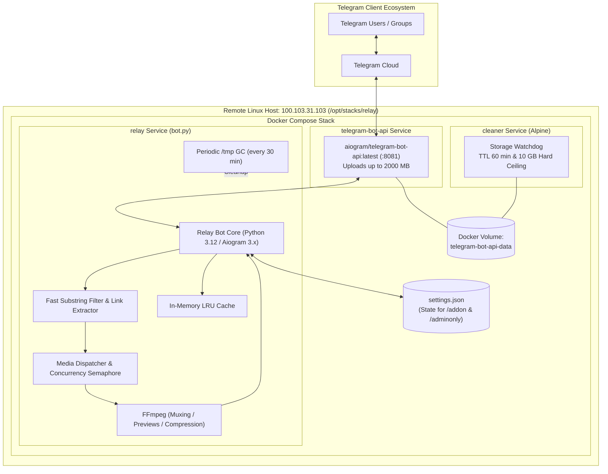
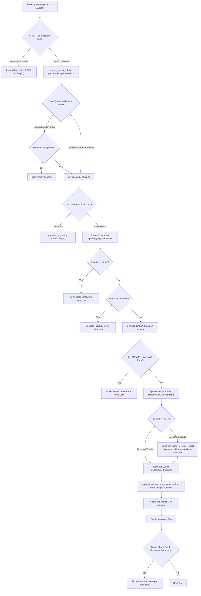
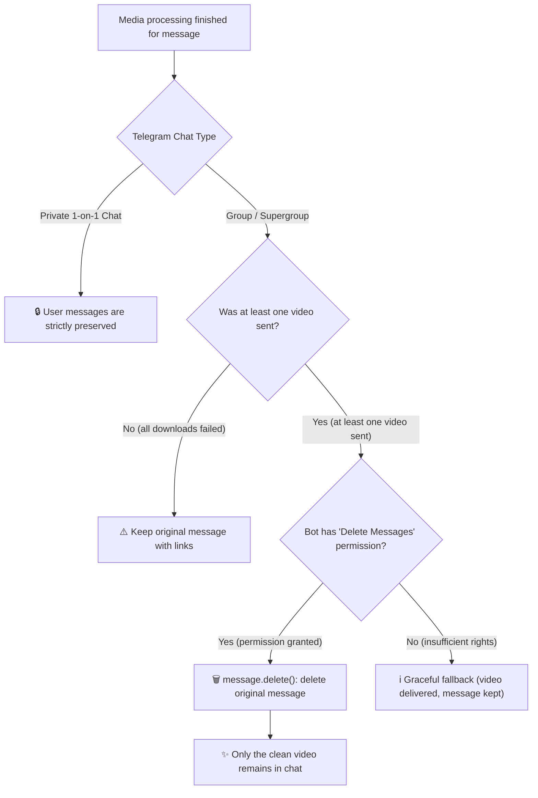
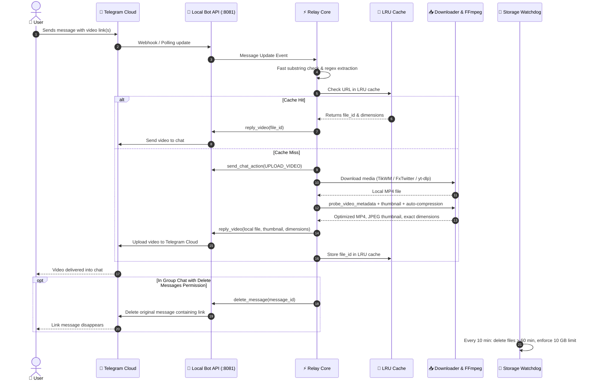

<div align="center">


# ⚡ Relay

**High-Performance Asynchronous Media Interceptor & Downloader for Telegram**  
*Високопродуктивний асинхронний бот для перехоплення та завантаження медіа без втрати якості та звуку*

[](https://github.com/vbazavliuk/Relay/actions/workflows/ci.yml)
[](https://www.python.org/)
[](https://docs.aiogram.dev/)
[](https://www.docker.com/)
[](https://core.telegram.org/bots/api#using-a-local-bot-api-server)
[](https://github.com/yt-dlp/yt-dlp)
[](https://ffmpeg.org/)
[](https://opensource.org/licenses/MIT)
[](https://github.com/astral-sh/ruff)

---

### 🌐 Select Language / Оберіть мову
[**🇺🇦 Українська**](#-українська) &nbsp;|&nbsp; [**🇬🇧 English**](#-english)

---

</div>

> [!WARNING]
> **DO NOT RUN LOCALLY ON MACOS. THIS STACK IS HOSTED ON REMOTE LINUX:**  
> `valentin@100.103.31.103` in `/opt/stacks/relay/`

<br/>

<a id="-українська"></a>
## 🇺🇦 Українська

**Relay** — це сучасний, високопродуктивний та асинхронний Telegram-бот для автоматичного перехоплення посилань і миттєвого завантаження відео безпосередньо у чат із **YouTube (Shorts / Reels / Відео)**, **TikTok**, **Instagram**, **X (Twitter)** та **Facebook**.

Проєкт розроблено з акцентом на **збереження оригінальних пропорцій відео** (вирішення проблеми «квадратних» та сплюснутих роликів у Telegram), **100% гарантію наявності звуку**, **завантаження великих файлів до 2000 МБ через локальний Telegram Bot API Server**, **інтелектуальне авто-стиснення відео до 400 МБ**, **синтез слайдшоу для фото-постів TikTok** та **розумний стелс-режим для групових чатів**.

---

### 📑 Зміст (Українська)

- [✨ Ключові можливості](#-ключові-можливості)
- [🚀 Підтримувані платформи та формати](#-підтримувані-платформи-та-формати)
- [🏛 Архітектура системи та схеми Mermaid](#-архітектура-системи-та-схеми-mermaid)
- [📐 Технічний опис: геометрія, аудіо та авто-стиснення](#-технічний-опис-геометрія-аудіо-та-авто-стиснення)
- [📂 Структура репозиторію](#-структура-репозиторію)
- [⚙️ Налаштування оточення (.env)](#️-налаштування-оточення-env)
- [🤖 Команди бота та адміністрування](#-команди-бота-та-адміністрування)
- [📦 Розгортання та запуск на сервері](#-розгортання-та-запуск-на-сервері)
- [💡 Налаштування для груп (BotFather)](#-налаштування-для-груп-botfather)
- [📚 Розширена технічна документація](#-розширена-технічна-документація)

---

### ✨ Ключові можливості

* 🚀 **Підтримка відеофайлів до 2000 МБ (2 ГБ)**: завдяки інтеграції з локальним `telegram-bot-api` сервером бот не обмежений стандартним лімітом Telegram Cloud у 50 МБ.
* 📦 **Пряме завантаження до 400 МБ та розумне авто-стиснення до 650 МБ**: файли до 400 МБ відправляються у максимальній якості; файли від 400 МБ до 650 МБ автоматично стискаються однопрохідним енкодером FFmpeg до ~380 МБ із підбором бітрейту.
* ⏱️ **Контроль тривалості відео**: автоматична фільтрація роликів довше 15 хвилин із дружнім поясненням користувачеві.
* 📸 **Генератор слайдшоу для фото-постів TikTok**: якщо посилання веде на карусель зображень, Relay завантажує фото та музичну доріжку і комбінує їх у плавне MP4-відео з чорним паддінгом, 25 fps та плавним аудіо-затуханням (fadeout).
* 🚀 **Пакетна обробка посилань (Multi-Link Batch Processing)**: якщо користувач надсилає кілька посилань в одному повідомленні (до 5 URL), бот паралельно завантажує всі ролики через `asyncio.gather()` без черг і пропусків.
* 🧹 **Стелс-режим / Очищення групових чатів (Clean Chat Mode)**: у групах, де бот має права адміністратора `Delete Messages`, після успішної доставки відео вихідне повідомлення з лінками безслідно видаляється. У чаті залишається лише чисте відео! В особистих повідомленнях листування **ніколи не видаляється**.
* 📐 **Ідеальні пропорції (Zero Distortion)**: глибокий аналіз метаданих через `ffprobe` (облік Sample Aspect Ratio та тегів орієнтації `rotate` 90°/270°) усуває сплюснутість та чорні рамки.
* 🔊 **100% гарантія звуку та Fast-Start**: зведення відеопотоку H.264 та аудіо AAC у MP4 з прапорцем `+faststart` (`moov` atom на початку файлу) для моментального стримінгу в Telegram.
* ⚡ **Блискавичний LRU-кеш**: раніше завантажені відео миттєво відправляються іншим користувачам за мілісекунди через Telegram `file_id` без повторного завантаження з мережі.
* 👥 **Керування в групах (/addon та /addoff)**: адміністратори групи можуть обмежити завантаження відео виключно для адмінів чату (`/addon`) або відкрити для всіх учасників (`/addoff`).
* 👑 **Глобальний режим обслуговування (/adminonly)**: бот-адміністратори (`ADMIN_IDS`) можуть перевести бота в режим технічних робіт однією командою.
* 🛡️ **Дворівнева гігієна пам'яті та диска**:
  - Внутрішній фоновий таск `periodic_temp_cleaner()` у Python очищає тимчасові файли `/tmp` кожні 30 хвилин.
  - Окремий Docker-контейнер `cleaner` (Alpine) кожні 10 хвилин видаляє файли кешу старше 60 хвилин і жорстко контролює ліміт сховища **10 ГБ**.

---

### 🚀 Підтримувані платформи та формати

| Платформа | Підтримувані формати | Метод завантаження & Особливості |
| :--- | :--- | :--- |
| **▶️ YouTube** | `shorts/...`, `youtu.be/...`, `watch?v=...` | До 1080p, зведення відео + аудіо в MP4, фільтрація прямих трансляцій `!is_live` |
| **🎵 TikTok** | `tiktok.com`, `vm.tiktok.com`, `vt.tiktok.com` | Без водяних знаків (TikWM API), підтримка фото-каруселей зі звуком (Slideshow Maker) + fallback на `yt-dlp` |
| **📸 Instagram** | `instagram.com/reel/...`, `/p/...`, `/tv/...`, share-лінки | Reels, пости, IGTV; оптимізація пропуску коментарів та підтримка `cookies.txt` |
| **🐦 X (Twitter)** | `x.com/...`, `twitter.com/...`, `fixupx.com/...` | Надшвидкий стрім MP4 з вибором максимального бітрейту через FxTwitter API v2 + резерв через `yt-dlp` |
| **🔷 Facebook** | `facebook.com/reel/...`, `fb.watch/...`, share-лінки | Reels, Watch, публічні відео; автоматичний резолв HTTP-редиректів коротких лінків |

---

### 🏛 Архітектура системи та схеми Mermaid

#### Схема 1: Багатоконтейнерна топологія Docker Compose


#### Схема 2: Конвеєр обробки повідомлення та завантаження медіа


#### Схема 3: Матриця прав та стелс-очищення чатів


#### Схема 4: Послідовність взаємодії компонентів у часі (Sequence Diagram)


---

### 📐 Технічний опис: геометрія, аудіо та авто-стиснення

#### 1. Збереження пропорцій (Aspect Ratio) та облік обертання
* **Аналіз `ffprobe`**: перед відправкою відео бот витягує розміри пікселів, Sample Aspect Ratio (SAR) та теги обертання камери смартфона (`rotate` 90°/270°).
* **Нормалізація габаритів**: якщо відео записане вертикально на мобільний телефон, ширина та висота міняються місцями для коректного рендерингу Telegram Desktop та мобільними додатками.
* **Пропорційне прев'ю**: генерується індивідуальний JPEG-кадр із обмеженням довшої сторони у 320px зі збереженням точного співвідношення сторін.

#### 2. Формула автоматичного стиснення відео
Якщо розмір завантаженого ролика перевищує 400 МБ, але не перевищує 650 МБ, бот виконує перекодування за формулою розрахунку цільового бітрейту для досягнення розміру 380 МБ:

$$\text{Цільові біти} = 380 \times 1024 \times 1024 \times 8$$

$$\text{Загальний бітрейт} = \frac{\text{Цільові біти}}{\text{Тривалість (сек)}}$$

$$\text{Відео бітрейт} = \max(\text{Загальний бітрейт} - 96000, 250000)$$

Параметри FFmpeg: `-c:v libx264 -preset veryfast -b:v {video_bitrate} -maxrate {1.2*video_bitrate} -bufsize {2*video_bitrate} -c:a aac -b:a 96k -movflags +faststart`.

---

### 📂 Структура репозиторію

```text
Relay/
├── .github/                      # CI/CD автоматизація та шаблони GitHub Issues
│   ├── workflows/ci.yml          # GitHub Actions лінтинг та перевірка синтаксису
│   └── ISSUE_TEMPLATE/           # Шаблони bug report та feature request
├── assets/                       # Брендові логотипи та аватари бота
│   ├── avatar.png
│   ├── avatar_clean.png
│   └── avatar_stealth.png
├── docs/                         # Поглиблена технічна документація
│   ├── ARCHITECTURE.md           # Детальний опис архітектури, потоків даних та FFmpeg
│   ├── MODULES.md                # Повний аудит класів, функцій та винятків у bot.py
│   └── DEPLOYMENT.md             # Інструкція з розгортання на сервері 100.103.31.103
├── AGENT_RULES.md                # Правила розгортання та хостингу на віддаленому сервері
├── bot.py                        # Головний виконуваний модуль бота (Python 3.12 / Aiogram 3.x)
├── CONTRIBUTING.md               # Інструкція для розробників та правила створення PR
├── docker-compose.yml            # Стек із 3 сервісів (telegram-bot-api, relay, cleaner)
├── Dockerfile                    # Багатошаровий Dockerfile на базі python:3.12-slim з FFmpeg
├── LICENSE                       # Ліцензія MIT
├── pyproject.toml                # Метадані проєкту та конфігурація Ruff
├── README.md                     # Документація проєкту (цей файл)
├── requirements.txt              # Залежності Python (aiogram, yt-dlp, static-ffmpeg тощо)
└── .env.example                  # Зразок конфігурації оточення з описом усіх змінних
```

---

### ⚙️ Налаштування оточення (`.env`)

Створіть файл конфігурації `.env` на сервері на основі `.env.example`:

```bash
cp .env.example .env
```

| Змінна | Опис | Тип | За замовчуванням | Обов'язкова |
| :--- | :--- | :--- | :--- | :--- |
| `BOT_TOKEN` | Токен Telegram-бота з [@BotFather](https://t.me/BotFather) | String | - | **Так** |
| `MAX_CONCURRENT_DOWNLOADS` | Ліміт одночасних важких завантажень через `yt-dlp` | Integer | `3` | Ні |
| `COOKIES_FILE` | Шлях до Netscape cookies для обходу блокувань Instagram / X | String | `cookies.txt` | Ні |
| `ADMIN_IDS` | Telegram ID глобальних адміністраторів через кому (`12345678,98765432`) | String | - | Ні |
| `SETTINGS_FILE` | Шлях до файлу збереження налаштувань режиму груп та обслуговування | String | `settings.json` | Ні |
| `TELEGRAM_API_ID` | API ID з [my.telegram.org](https://my.telegram.org) для локального сервера Bot API | Integer | - | Рекомендовано |
| `TELEGRAM_API_HASH` | API Hash з [my.telegram.org](https://my.telegram.org) для локального сервера Bot API | String | - | Рекомендовано |
| `TELEGRAM_API_SERVER` | Адреса локального Bot API сервера | String | `http://telegram-bot-api:8081` | Рекомендовано |
| `MAX_VIDEO_DURATION_SECONDS` | Максимально дозволена тривалість відео у секундах (15 хв) | Integer | `900` | Ні |
| `MAX_FILE_SIZE_MB` | Максимальний розмір відео для прямого завантаження (в МБ) | Integer | `400` | Ні |
| `MAX_COMPRESS_SIZE_MB` | Поріг розміру для авто-стиснення відео (в МБ) | Integer | `650` | Ні |

---

### 🤖 Команди бота та адміністрування

| Команда | Аліаси | Рівень доступу | Опис |
| :--- | :--- | :--- | :--- |
| `/start` | - | Усі користувачі | Привітання, опис підтримуваних платформ та інструкції. |
| `/help` | - | Усі користувачі | Детальна довідка з використання, лімітів та налаштування груп. |
| `/ping` | - | Усі користувачі | Перевірка працездатності, показ вашого User ID та поточних статусів. |
| `/addon` | `/adminon`, `/add_on`, `/admin_on` | Адміністратори групи | Вмикає режим, коли бот завантажує відео **лише за лінками від адмінів групи**. |
| `/addoff` | `/adminoff`, `/add_off`, `/admin_off` | Адміністратори групи | Вимикає обмеження, відкриваючи завантаження відео для **всіх учасників групи**. |
| `/addstatus` | `/adminstatus`, `/add_status` | Усі учасники групи | Показує поточний статус режиму завантаження у даній групі. |
| `/add [on\|off\|status]` | - | Адміністратори групи | Універсальна команда перемикання або перевірки режиму в групі. |
| `/adminonly [on\|off\|status]` | `/maintenance` | Бот-адміни (`ADMIN_IDS`) | Керування глобальним режимом обслуговування (технічних робіт). |

---

### 📦 Розгортання та запуск на сервері

> [!IMPORTANT]
> Розгортання здійснюється на віддаленому хості `valentin@100.103.31.103` у каталозі `/opt/stacks/relay/`.

```bash
# 1. Підключення до сервера через SSH (Tailscale)
ssh valentin@100.103.31.103

# 2. Перехід до каталогу стеку
cd /opt/stacks/relay

# 3. Збірка та запуск 3-контейнерного стеку у фоновому режимі
docker compose up -d --build

# 4. Перегляд статусів контейнерів
docker compose ps

# 5. Моніторинг журналу логів у реальному часі
docker compose logs -f --tail=100
```

---

### 💡 Налаштування для груп (BotFather)

1. **Читання посилань без слеш-команд**:
   - Надішліть `/mybots` у [@BotFather](https://t.me/BotFather) → оберіть бота → **Bot Settings** → **Group Privacy** → натисніть **Turn off**.
2. **Стелс-режим (видалення повідомлень із лінками)**:
   - Додайте Relay до вашої групи як адміністратора з правом **Delete Messages**.
   - Після цього Relay завантажить відео, надішле його в чат і безслідно видалить вихідне повідомлення з лінком!

---

### 📚 Розширена технічна документація

- [docs/ARCHITECTURE.md](./docs/ARCHITECTURE.md) — Повний архітектурний опис, потоки даних, математика стиснення та алгоритми FFmpeg.
- [docs/MODULES.md](./docs/MODULES.md) — Докладний аудит усіх функцій, класів та винятків у `bot.py`.
- [docs/DEPLOYMENT.md](./docs/DEPLOYMENT.md) — Повний посібник із розгортання, роботи з Tailscale, Dockge та діагностики помилок.

---

<br/>

<a id="-english"></a>
## 🇬🇧 English

**Relay** is a state-of-the-art, high-performance, and asynchronous Telegram bot engineered for automated link interception and seamless video downloads directly into your chat from **YouTube (Shorts / Reels / Videos)**, **TikTok**, **Instagram**, **X (Twitter)**, and **Facebook**.

Specifically engineered to eliminate the infamous **Telegram square/squished video distortion**, guarantee **100% audio retention**, support **large video files up to 2000 MB via a local Telegram Bot API Server**, provide **intelligent auto-compression for files up to 650 MB**, generate **TikTok photo-mode slideshow videos**, and deliver **smart stealth cleanup in group chats**.

---

### 📑 Table of Contents (English)

- [✨ Key Features](#-key-features)
- [🚀 Supported Platforms & Formats](#-supported-platforms--formats)
- [🏛 System Architecture & Mermaid Diagrams](#-system-architecture--mermaid-diagrams)
- [📐 Technical Deep-Dive: Proportions, Audio & Auto-Compression](#-technical-deep-dive-proportions-audio--auto-compression)
- [📂 Repository Structure](#-repository-structure)
- [⚙️ Environment Configuration (.env)](#️-environment-configuration-env)
- [🤖 Bot Commands & Administration](#-bot-commands--administration)
- [📦 Deployment & Remote Execution](#-deployment--remote-execution)
- [💡 Group Chat Configuration (BotFather)](#-group-chat-configuration-botfather)
- [📚 Extended Technical Documentation](#-extended-technical-documentation)

---

### ✨ Key Features

* 🚀 **Large Video Support up to 2000 MB (2 GB)**: powered by a dedicated local `telegram-bot-api` service, eliminating the cloud Bot API 50 MB file limitation.
* 📦 **Direct 400 MB Uploads & Smart Compression up to 650 MB**: media under 400 MB is delivered in original source quality; files between 400 MB and 650 MB are automatically re-encoded via single-pass FFmpeg to ~380 MB using dynamic bitrate allocation.
* ⏱️ **Duration Pre-flight Checks**: rejects videos longer than 15 minutes (`MAX_VIDEO_DURATION_SECONDS = 900`) before downloading, saving server bandwidth and displaying polite user notices.
* 📸 **TikTok Photo Slideshow Builder**: converts TikTok image carousel posts (`data.images`) and audio tracks into smooth 1080p MP4 videos with dynamic slide pacing, black letterboxing, 25 fps, and smooth audio fadeout.
* 🚀 **Multi-Link Batch Processing**: paste up to 5 URLs in a single message or consecutive messages; Relay processes all media concurrently using `asyncio.gather()`.
* 🧹 **Clean Chat / Stealth Mode**: in group chats where Relay is granted administrator privileges with the `Delete Messages` permission, the original message containing the links is automatically deleted once video delivery succeeds. Direct 1-on-1 private messages are **never deleted**.
* 📐 **Zero Aspect Ratio Distortion**: deep video inspection via `ffprobe` (accounting for Sample Aspect Ratio and smartphone `rotate` 90°/270° orientation tags) guarantees videos are never squished into 1:1 boxes.
* 🔊 **100% Sound Guarantee & Fast-Start**: stream muxing of video (H.264/AVC) and audio (AAC) into MP4 with `-movflags +faststart` (`moov` atom at file start) for immediate streaming in Telegram.
* ⚡ **Ultra-Fast LRU Memory Cache**: previously downloaded videos are re-sent within milliseconds using cached Telegram `file_id` references, saving bandwidth and VPS CPU.
* 👥 **Per-Group Admin-Only Mode (/addon & /addoff)**: group admins can restrict Relay to process links exclusively from administrators (`/addon`) or open access to all members (`/addoff`).
* 👑 **Global Maintenance Mode (/adminonly)**: bot owners (`ADMIN_IDS`) can switch Relay into maintenance mode across all private and group chats with one command.
* 🛡️ **Two-Tier Storage & Memory Hygiene**:
  - Python internal `periodic_temp_cleaner()` purges `/tmp` directories older than 30 minutes every 30 minutes.
  - Dedicated Alpine `cleaner` container deletes media cache older than 60 minutes and enforces a strict **10 GB hard ceiling** on Docker volumes.

---

### 🚀 Supported Platforms & Formats

| Platform | Supported Formats | Engine & Highlights |
| :--- | :--- | :--- |
| **▶️ YouTube** | `shorts/...`, `youtu.be/...`, `watch?v=...` | Up to 1080p, stream muxing (video + audio in MP4), live stream filter `!is_live` |
| **🎵 TikTok** | `tiktok.com`, `vm.tiktok.com`, `vt.tiktok.com` | Watermark-free downloads via TikWM API, Photo Slideshow synthesis with music + fallback to `yt-dlp` |
| **📸 Instagram** | `instagram.com/reel/...`, `/p/...`, `/tv/...`, share links | Reels, posts, IGTV; comment stripping optimization and session auth via `cookies.txt` |
| **🐦 X (Twitter)** | `x.com/...`, `twitter.com/...`, `fixupx.com/...` | Lightning-fast MP4 stream with bitrate sorting via FxTwitter API v2 + fallback to `yt-dlp` |
| **🔷 Facebook** | `facebook.com/reel/...`, `fb.watch/...`, share links | Reels, Watch, public videos; automated HTTP redirect unshortening for short URLs |

---

### 🏛 System Architecture & Mermaid Diagrams

#### Diagram 1: Multi-Container Docker Stack Architecture


#### Diagram 2: Message Ingestion & Media Processing Pipeline


#### Diagram 3: Group Moderation & Stealth Cleanup Flowchart


#### Diagram 4: Component Execution Sequence Diagram


---

### 📐 Technical Deep-Dive: Proportions, Audio & Auto-Compression

#### 1. Zero Aspect Ratio Distortion
* **`ffprobe` Inspection**: Parses streams for pixel dimensions, Sample Aspect Ratio (SAR), and camera rotation metadata (`rotate` 90°/270° from vertical smartphone captures).
* **Dimension Normalization**: Width and height are recalculated according to display aspect ratios, ensuring no horizontal stretching or vertical flattening.
* **Proportional Thumbnail**: Generates a custom JPEG thumbnail capped at 320px along its longest side, guaranteeing clean previews on iOS, Android, and Desktop clients.

#### 2. Dynamic Video Bitrate Compression Formula
When a video file is between 400 MB and 650 MB, Relay re-encodes the stream to fit strictly under 380 MB:

$$\text{Target Bits} = 380 \times 1024 \times 1024 \times 8$$

$$\text{Total Bitrate} = \frac{\text{Target Bits}}{\text{Duration (seconds)}}$$

$$\text{Video Bitrate} = \max(\text{Total Bitrate} - 96000, 250000)$$

FFmpeg arguments: `-c:v libx264 -preset veryfast -b:v {video_bitrate} -maxrate {1.2*video_bitrate} -bufsize {2*video_bitrate} -c:a aac -b:a 96k -movflags +faststart`.

---

### 📂 Repository Structure

```text
Relay/
├── .github/                      # CI/CD automation & issue templates
│   ├── workflows/ci.yml          # GitHub Actions syntax and linting checks
│   └── ISSUE_TEMPLATE/           # Bug report and feature request templates
├── assets/                       # Branding assets & bot avatars
│   ├── avatar.png
│   ├── avatar_clean.png
│   └── avatar_stealth.png
├── docs/                         # Extended technical documentation
│   ├── ARCHITECTURE.md           # Deep dive into architecture, data flows & FFmpeg
│   ├── MODULES.md                # Line-by-line audit of classes, functions & exceptions
│   └── DEPLOYMENT.md             # Production deployment guide for 100.103.31.103
├── AGENT_RULES.md                # Remote-only server hosting guidelines
├── bot.py                        # Core application executable (Python 3.12 / Aiogram 3.x)
├── CONTRIBUTING.md               # Developer setup and PR contribution guidelines
├── docker-compose.yml            # 3-service stack definition (telegram-bot-api, relay, cleaner)
├── Dockerfile                    # Multi-stage production container image
├── LICENSE                       # MIT License
├── pyproject.toml                # Project metadata & Ruff configuration
├── README.md                     # Documentation entry point (this file)
├── requirements.txt              # Production Python dependencies
└── .env.example                  # Environment template with documented defaults
```

---

### ⚙️ Environment Configuration (`.env`)

Create your `.env` configuration file on the server from the template:

```bash
cp .env.example .env
```

| Variable | Description | Type | Default | Required |
| :--- | :--- | :--- | :--- | :--- |
| `BOT_TOKEN` | Telegram Bot Token obtained from [@BotFather](https://t.me/BotFather) | String | - | **Yes** |
| `MAX_CONCURRENT_DOWNLOADS` | Limit on simultaneous heavy `yt-dlp` download jobs | Integer | `3` | No |
| `COOKIES_FILE` | Path to Netscape cookies file for bypassing platform limits | String | `cookies.txt` | No |
| `ADMIN_IDS` | Comma-separated administrator Telegram User IDs (`12345678,98765432`) | String | - | No |
| `SETTINGS_FILE` | Path to persisted JSON settings file for runtime state | String | `settings.json` | No |
| `TELEGRAM_API_ID` | API ID from [my.telegram.org](https://my.telegram.org) for local Bot API server | Integer | - | Recommended |
| `TELEGRAM_API_HASH` | API Hash from [my.telegram.org](https://my.telegram.org) for local Bot API server | String | - | Recommended |
| `TELEGRAM_API_SERVER` | Address of local Telegram Bot API Server | String | `http://telegram-bot-api:8081` | Recommended |
| `MAX_VIDEO_DURATION_SECONDS` | Maximum allowed video duration in seconds (15 minutes) | Integer | `900` | No |
| `MAX_FILE_SIZE_MB` | Maximum video file size for direct upload in megabytes | Integer | `400` | No |
| `MAX_COMPRESS_SIZE_MB` | Maximum video file size threshold for auto-compression in megabytes | Integer | `650` | No |

---

### 🤖 Bot Commands & Administration

| Command | Aliases | Access Level | Description |
| :--- | :--- | :--- | :--- |
| `/start` | - | Public | Welcome banner and supported platforms overview. |
| `/help` | - | Public | Usage guidelines, group instructions, and active limits. |
| `/ping` | - | Public | Health check displaying User ID, Global Admin mode, and Group mode. |
| `/addon` | `/adminon`, `/add_on`, `/admin_on` | Group Admin | Restricts group downloading exclusively to group admins. |
| `/addoff` | `/adminoff`, `/add_off`, `/admin_off` | Group Admin | Restores open downloading for all group members. |
| `/addstatus` | `/adminstatus`, `/add_status` | Public | Displays current `/addon` restriction status for the group. |
| `/add [on\|off\|status]` | - | Group Admin | Unified multi-purpose switch or toggle for group mode. |
| `/adminonly [on\|off\|status]` | `/maintenance` | Bot Admin (`ADMIN_IDS`) | Global maintenance mode switch. Persisted in `settings.json`. |

---

### 📦 Deployment & Remote Execution

> [!IMPORTANT]
> The production stack is deployed remotely on `valentin@100.103.31.103` under `/opt/stacks/relay/`.

```bash
# 1. Connect via SSH (Tailscale network)
ssh valentin@100.103.31.103

# 2. Navigate to the stack directory
cd /opt/stacks/relay

# 3. Build and launch all 3 containers in background
docker compose up -d --build

# 4. Check running service status
docker compose ps

# 5. Inspect real-time live logs
docker compose logs -f --tail=100
```

---

### 💡 Group Chat Configuration (BotFather)

1. **Enable Automatic Link Reading**:
   - Send `/mybots` to [@BotFather](https://t.me/BotFather) → select your bot → **Bot Settings** → **Group Privacy** → click **Turn off**.
2. **Enable Clean Chat Mode (Stealth Link Deletion)**:
   - Promote Relay to **Administrator** in your group with the **Delete Messages** permission.
   - When a user posts a video link, Relay will deliver the video and immediately clean up the link message!

---

### 📚 Extended Technical Documentation

- [docs/ARCHITECTURE.md](./docs/ARCHITECTURE.md) — Comprehensive technical breakdown of system components, data flows, and FFmpeg pipelines.
- [docs/MODULES.md](./docs/MODULES.md) — Line-by-line audit and reference guide for all classes, functions, and exceptions in `bot.py`.
- [docs/DEPLOYMENT.md](./docs/DEPLOYMENT.md) — Complete operations manual for remote host `100.103.31.103`, Tailscale, and Docker Compose.

---

### 📄 License

This project is open-sourced under the [MIT License](LICENSE).
