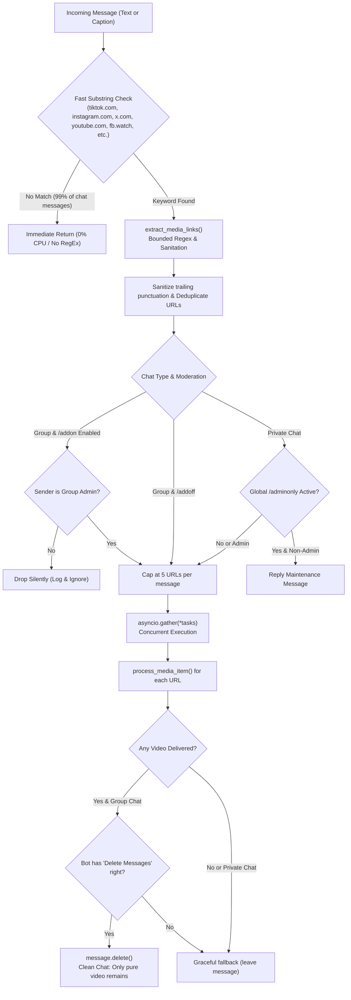
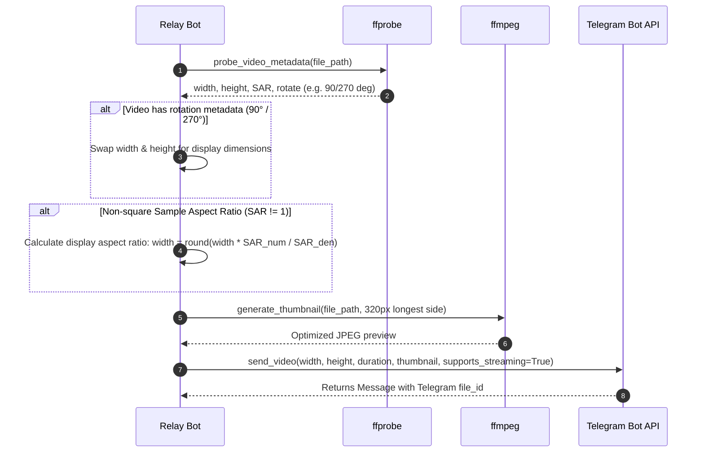
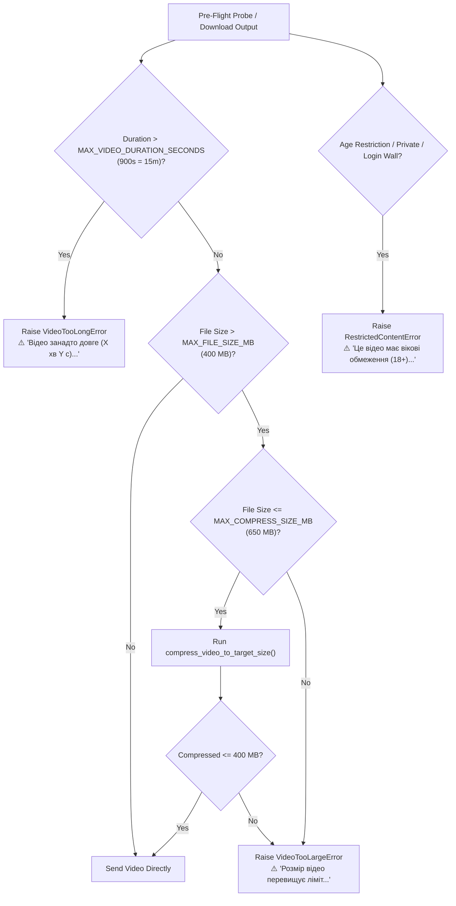
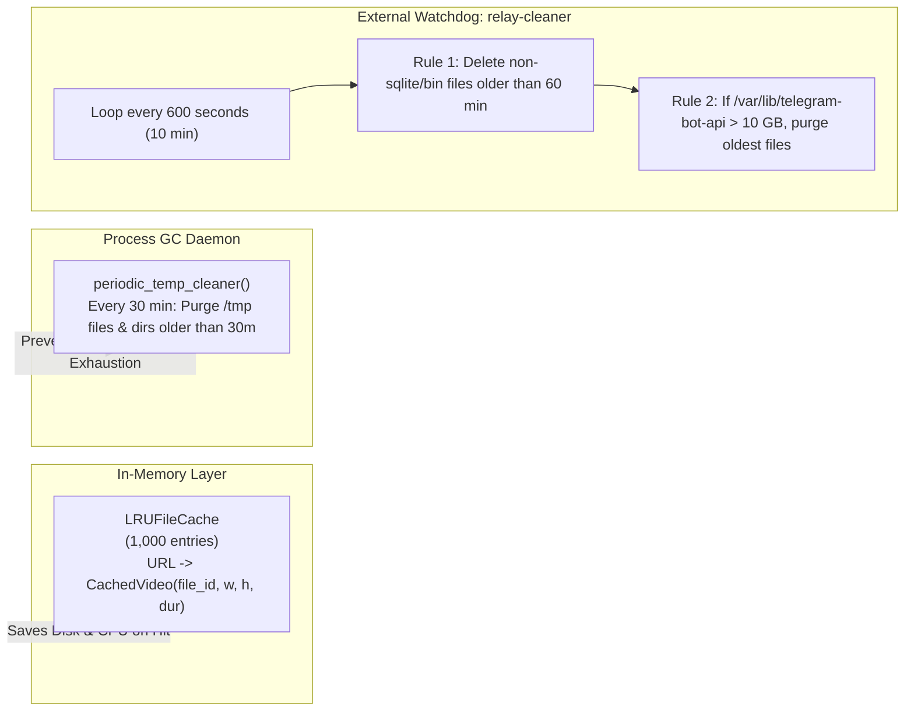

# 🏛 Relay Architecture & Technical Specification

This document provides a comprehensive technical overview of the architecture, data flows, media pipelines, and infrastructure powering **Relay**.

---

## 📑 Table of Contents

- [1. System Topology](#1-system-topology)
- [2. Multi-Container Orchestration](#2-multi-container-orchestration)
- [3. Message Lifecycle & Ingestion Pipeline](#3-message-lifecycle--ingestion-pipeline)
- [4. Platform-Specific Download Engines](#4-platform-specific-download-engines)
  - [TikTok & Slideshow Synthesis Engine](#tiktok--slideshow-synthesis-engine)
  - [Twitter / X Fast-Path & Resolution](#twitter--x-fast-path--resolution)
  - [YouTube & Instagram Stream Muxing](#youtube--instagram-stream-muxing)
  - [Facebook Redirect Resolution](#facebook-redirect-resolution)
- [5. Video Geometry & Aspect Ratio Normalization](#5-video-geometry--aspect-ratio-normalization)
- [6. Dynamic Bitrate Compression Algorithm](#6-dynamic-bitrate-compression-algorithm)
- [7. Error Handling & Constraint Enforcement](#7-error-handling--constraint-enforcement)
- [8. Storage, Memory & Maintenance Daemons](#8-storage-memory--maintenance-daemons)
- [9. Group Moderation & Stealth Execution](#9-group-moderation--stealth-execution)

---

## 1. System Topology

Relay is deployed as an asynchronous microservices stack on a remote Linux server (`valentin@100.103.31.103` in `/opt/stacks/relay/`). It decouples media ingestion, Telegram Bot API processing, and background storage maintenance across three coordinated Docker services.

```mermaid
flowchart TD
    subgraph ClientSpace["Telegram Client Ecosystem"]
        User["Telegram Users / Groups"]
        TGCloud["Telegram Cloud Servers"]
    end

    subgraph Host["Remote Linux Host: 100.103.31.103 (/opt/stacks/relay)"]
        subgraph DockerCompose["Docker Compose Stack"]
            subgraph TGAPIService["telegram-bot-api Service"]
                LocalAPI["aiogram/telegram-bot-api:latest<br/>(Local API Server :8081)"]
            end

            subgraph RelayService["relay Service"]
                BotCore["Relay Bot Core (Python 3.12 / Aiogram 3.x)"]
                FastFilter["Fast Substring Filter & Link Extractor"]
                Dispatch["Media Dispatcher & Concurrency Semaphore"]
                FFmpegEngine["FFmpeg & FFprobe Media Engine"]
                CacheEngine["In-Memory LRU Cache"]
                TempGC["Periodic /tmp Cleaner (30 min)"]
            end

            subgraph CleanerService["cleaner Service"]
                AlpineCleaner["Storage Manager (Alpine)<br/>60m Age Cleanup & 10 GB Hard Limit"]
            end

            Volume[("Docker Volume:<br/>telegram-bot-api-data")]
            SettingsFile[("settings.json<br/>(Admin & Group State)")]
        end
    end

    subgraph UpstreamProviders["Upstream Media Platforms & APIs"]
        TikTokAPI["TikWM HD API & CDN"]
        TwitterAPI["FxTwitter API v2"]
        YTDLP["yt-dlp Extraction (YouTube / IG / FB)"]
        DirectCDN["Origin Media CDNs"]
    end

    User <-->|Encrypted MTProto| TGCloud
    TGCloud <-->|Bot API Webhook / Polling| LocalAPI
    LocalAPI <-->|HTTP POST :8081 (Files up to 2000 MB)| BotCore
    BotCore <-->|State Persistence| SettingsFile

    BotCore --> FastFilter
    FastFilter --> Dispatch
    Dispatch --> TikTokAPI & TwitterAPI & YTDLP
    TikTokAPI & TwitterAPI & YTDLP --> DirectCDN
    DirectCDN --> FFmpegEngine
    FFmpegEngine --> BotCore
    BotCore --> CacheEngine

    LocalAPI --- Volume
    AlpineCleaner --- Volume
    TempGC -.->|Purge /tmp| RelayService
```

---

## 2. Multi-Container Orchestration

The application stack consists of three specialized services defined in [`docker-compose.yml`](../docker-compose.yml):

| Service | Image | Purpose | Resources & Constraints |
| :--- | :--- | :--- | :--- |
| `telegram-bot-api` | `aiogram/telegram-bot-api:latest` | Local Telegram Bot API server that increases file upload limits from 50 MB to **2000 MB (2 GB)**. | Runs on port `8081`, mounts `telegram-bot-api-data` to `/var/lib/telegram-bot-api`. Configured with `TELEGRAM_API_ID` and `TELEGRAM_API_HASH`. |
| `relay` | Custom (`Dockerfile`, Python 3.12-slim) | Core application running `bot.py`, handling Telegram polling, platform downloading, metadata probing, video compression, and group cleanup. | Depends on `telegram-bot-api`. Mounts `settings.json` for persistent storage of group `/addon` and global `/adminonly` states. |
| `cleaner` | `alpine:latest` | Continuous storage watchdog. Enforces a 60-minute retention policy on cached media and a strict **10 GB hard ceiling** on the shared volume. | Mounts `telegram-bot-api-data`. Executes a 10-minute polling cycle (`sleep 600`). |

---

## 3. Message Lifecycle & Ingestion Pipeline

Every message received in private or group chats passes through a zero-overhead pipeline designed to minimize CPU and RAM consumption:



---

## 4. Platform-Specific Download Engines

Relay implements customized download and re-encoding workflows for each supported media platform.

### TikTok & Slideshow Synthesis Engine

TikTok links undergo dual-stage processing:

1. **TikWM REST API**: Queries `https://www.tikwm.com/api/` with `hd=1`.
2. **Photo-Mode Slideshows**: If the post contains static images (`data.images`):
   - Images and background audio (`data.music` or `data.play`) are downloaded concurrently.
   - `create_tiktok_slideshow_sync` synthesizes an MP4 video using FFmpeg:
     - Slide duration: scaled dynamically based on image count (1 image = 4.0s, 2-6 images = 3.0s, 7-12 images = 2.5s, >12 images = 2.0s).
     - Canvas sizing: 1920x1080 (landscape) or 1080x1920 (portrait) based on the first image geometry.
     - Individual image filters: `scale=...:force_original_aspect_ratio=decrease, pad=...:(ow-iw)/2:(oh-ih)/2:color=black, setsar=1, fps=25`.
     - Audio: Looped over total duration with an `afade=t=out:st=...:d=0.5` half-second fadeout. If no audio exists, `anullsrc=r=44100:cl=stereo` produces a clean silent audio track.
3. **Video Fallback**: If TikWM fails or encounters rate limits, execution falls back automatically to `yt-dlp`.

### Twitter / X Fast-Path & Resolution

1. **FxTwitter API v2**: Queries `https://api.fxtwitter.com/2/status/{tweet_id}`.
2. **Bitrate Selection**: Iterates through all available MP4 streams in `media.videos[0].formats` and selects the stream with the highest bitrate.
3. **Chunked Direct Stream**: Downloads the MP4 via `aiohttp` directly to disk without spawning heavy Python subprocesses.
4. **Fallback**: If FxTwitter returns no video or fails, `download_twitter_sync` falls back to `yt-dlp`.

### YouTube & Instagram Stream Muxing

YouTube (Shorts, Clips, Videos) and Instagram (Reels, Posts, IGTV) utilize `yt-dlp` wrapped with a multi-layered format selector:

```text
bestvideo[height<=1080][filesize_approx<=?400M][vcodec^=avc][ext=mp4]+bestaudio[acodec^=mp4a]/
bestvideo[height<=1080][filesize_approx<=?400M][ext=mp4]+bestaudio[ext=m4a]/
bestvideo[height<=1080][filesize_approx<=?400M]+bestaudio/
bestvideo[height<=720][filesize_approx<=?400M]+bestaudio/
best[height<=1080][filesize_approx<=?400M][ext=mp4]/
best[height<=1080][filesize_approx<=?400M]/
best[filesize_approx<=?400M]/
bestvideo[height<=720]+bestaudio/
best[height<=720]/
best
```

Key features:
- **Fast-Start Streaming**: Post-processor passes `-movflags +faststart` to place the `moov` atom at the start of the container, enabling immediate playback before full file download.
- **Live Stream Rejection**: Pre-download check filters out live broadcasts (`is_live`).

### Facebook Redirect Resolution

Facebook share links (`fb.watch/*`, `facebook.com/share/*`) often use dynamic 302/301 redirects that break standard extractors.
`resolve_facebook_url()` performs asynchronous HTTP header inspection with browser User-Agents to expand short links to canonical URLs before invoking `yt-dlp`. If resolution fails, it automatically retries with the raw link.

---

## 5. Video Geometry & Aspect Ratio Normalization

To eliminate Telegram's notorious "squished video" and square letterboxing bugs:



---

## 6. Dynamic Bitrate Compression Algorithm

When downloaded media exceeds `MAX_FILE_SIZE_MB` (400 MB) but is within `MAX_COMPRESS_SIZE_MB` (650 MB), Relay automatically executes single-pass bitrate-targeted compression:

$$\text{Target Total Bits} = \text{TargetSizeMB} \times 1024 \times 1024 \times 8$$

$$\text{Total Bitrate} = \left\lfloor \frac{\text{Target Total Bits}}{\max(\text{Duration}, 1)} \right\rfloor$$

$$\text{Video Bitrate} = \max(\text{Total Bitrate} - 96000, 250000)$$

FFmpeg parameters:
- `-c:v libx264` with `-preset veryfast`
- `-b:v {video_bitrate}`
- `-maxrate {int(video_bitrate * 1.2)}`
- `-bufsize {int(video_bitrate * 2)}`
- `-c:a aac -b:a 96k`
- `-movflags +faststart`

If compression succeeds and the output file is $\le 380 \text{ MB} \times 1.05$, the compressed file is transmitted seamlessly.

---

## 7. Error Handling & Constraint Enforcement



---

## 8. Storage, Memory & Maintenance Daemons

Relay maintains a strict two-tier storage hygiene system to guarantee production VPS stability:



---

## 9. Group Moderation & Stealth Execution

Relay provides per-group and global access controls:

- **Per-Group `/addon` Mode**:
  - Restricts download execution to group administrators.
  - Chat administrator lists are fetched via `bot.get_chat_administrators(chat_id)` and cached in memory with a 5-minute TTL (`CHAT_ADMIN_CACHE_TTL = 300`).
  - Supports anonymous administrators (`sender_chat.id == chat.id`) and global bot administrators (`ADMIN_IDS`).
- **Clean Chat Stealth Cleanup**:
  - When the bot has the `Delete Messages` administrator permission in groups, the original message containing the media links is deleted upon successful video delivery.
  - In direct 1-on-1 private chats, user messages are **never deleted**.
- **Global `/adminonly` Mode**:
  - Toggles global maintenance mode. Non-admin commands and media requests are dropped or answered with a friendly maintenance notice.
