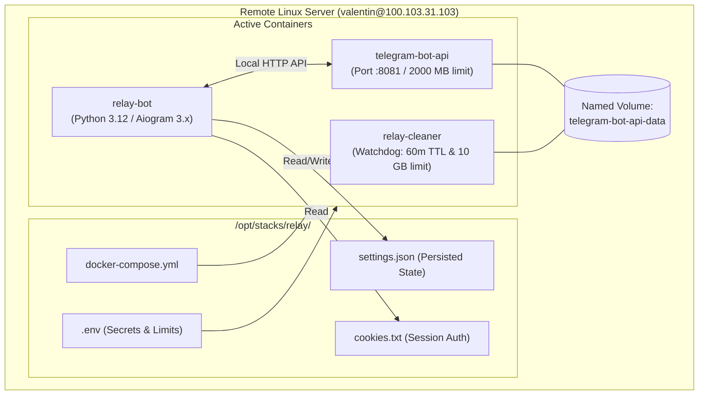

# 🚀 Relay Deployment & Operations Guide

This guide details the deployment, configuration, monitoring, and maintenance of **Relay** on production infrastructure.

---

## 📑 Table of Contents

- [1. Production Architecture Overview](#1-production-architecture-overview)
- [2. Prerequisites & Server Environment](#2-prerequisites--server-environment)
- [3. Obtaining Telegram API Credentials](#3-obtaining-telegram-api-credentials)
- [4. Configuration (`.env`)](#4-configuration-env)
- [5. Deployment via Docker Compose](#5-deployment-via-docker-compose)
- [6. File Synchronization Workflow](#6-file-synchronization-workflow)
- [7. Monitoring & Log Inspection](#7-monitoring--log-inspection)
- [8. Troubleshooting & Common Scenarios](#8-troubleshooting--common-scenarios)

---

## 1. Production Architecture Overview

> [!WARNING]
> **DO NOT RUN DOCKER LOCALLY ON MACOS.**  
> Relay is engineered and hosted as a multi-container stack on a remote Linux server:  
> **Host**: `valentin@100.103.31.103` (via Tailscale)  
> **Stack Directory**: `/opt/stacks/relay/`

The production stack consists of three coordinated Docker containers:



---

## 2. Prerequisites & Server Environment

### Remote Host Requirements
- **OS**: Linux (Debian 12 / Ubuntu 22.04+ recommended)
- **Networking**: Tailscale VPN enabled (reachable at `100.103.31.103`) or LAN (`192.168.1.110`)
- **Runtimes**: Docker Engine 24.x+ and Docker Compose v2 (e.g. `docker compose`)
- **System Storage**: At least 25 GB free disk space for cache volume and images

---

## 3. Obtaining Telegram API Credentials

To support large video uploads up to **2000 MB (2 GB)** without hitting the standard cloud Bot API 50 MB limit, a local `telegram-bot-api` server is used.

1. Log into the Telegram Developer Portal at [https://my.telegram.org](https://my.telegram.org).
2. Navigate to **API development tools**.
3. Create a new application (e.g., App title: `Relay Media Server`, Short name: `relay`).
4. Copy your **`api_id`** (integer) and **`api_hash`** (32-character string).
5. Add them to your `.env` file on the server.

---

## 4. Configuration (`.env`)

Create or update `/opt/stacks/relay/.env` on the remote server:

```ini
# ==============================================================================
# Relay Telegram Bot Configuration
# ==============================================================================

# Required: Telegram Bot Token from @BotFather
BOT_TOKEN=1234567890:ABCdefGhIJKlmNoPQRstuVWXyz

# Optional: Concurrency limit for simultaneous media downloads (Default: 3)
MAX_CONCURRENT_DOWNLOADS=3

# Optional: Path to Netscape cookies file for Instagram / X (Default: cookies.txt)
COOKIES_FILE=cookies.txt

# Optional: Telegram User IDs of administrators (comma-separated)
ADMIN_IDS=12345678,98765432

# Optional: Path to persisted settings file (Default: settings.json)
SETTINGS_FILE=settings.json

# ==============================================================================
# Local Telegram Bot API Server Configuration (up to 2000 MB)
# ==============================================================================
TELEGRAM_API_ID=12345678
TELEGRAM_API_HASH=abcdef0123456789abcdef0123456789
TELEGRAM_API_SERVER=http://telegram-bot-api:8081

# ==============================================================================
# Media Limits & Auto-Compression
# ==============================================================================
# Maximum video duration in seconds (Default: 900 = 15 minutes)
MAX_VIDEO_DURATION_SECONDS=900

# Maximum video file size for direct upload in megabytes (Default: 400 MB)
MAX_FILE_SIZE_MB=400

# Maximum video file size threshold for auto-compression in megabytes (Default: 650 MB)
MAX_COMPRESS_SIZE_MB=650
```

---

## 5. Deployment via Docker Compose

All stack lifecycle commands must be run directly on the remote Linux host.

### Connect to Remote Server
```bash
ssh valentin@100.103.31.103
cd /opt/stacks/relay
```

### Initial Build & Launch
```bash
# Build Relay container and spin up all 3 services in background
docker compose up -d --build
```

### Check Container Status
```bash
docker compose ps
```

Expected output:
```text
NAME                IMAGE                            COMMAND                  SERVICE             CREATED         STATUS         PORTS
relay-bot           relay-relay                      "python bot.py"          relay               Up 2 hours      Up 2 hours     
relay-cleaner       alpine:latest                    "sh -c '\n  while tr…"   cleaner             Up 2 hours      Up 2 hours     
telegram-bot-api    aiogram/telegram-bot-api:latest  "/entrypoint.sh --di…"   telegram-bot-api    Up 2 hours      Up 2 hours     8081/tcp
```

### Stopping or Restarting Stack
```bash
# Restart entire stack
docker compose restart

# Graceful teardown
docker compose down
```

---

## 6. File Synchronization Workflow

When making code modifications locally, synchronize the repository to the remote stack destination:

```bash
# From your local machine in the Relay repository directory:
rsync -avz --exclude '.git' --exclude '.env' --exclude '__pycache__' ./ valentin@100.103.31.103:/opt/stacks/relay/

# Rebuild and restart the daemon remotely:
ssh valentin@100.103.31.103 "cd /opt/stacks/relay && docker compose build relay && docker compose up -d"
```

---

## 7. Monitoring & Log Inspection

### Real-Time Live Logs
```bash
# Stream live logs across all containers:
ssh valentin@100.103.31.103 "cd /opt/stacks/relay && docker compose logs -f --tail=100"

# Stream logs exclusively for the Relay bot:
ssh valentin@100.103.31.103 "cd /opt/stacks/relay && docker compose logs -f --tail=100 relay"

# Inspect storage cleaner actions:
ssh valentin@100.103.31.103 "cd /opt/stacks/relay && docker compose logs -f --tail=50 cleaner"
```

### Disk Usage Verification
```bash
# Check Docker volume size:
ssh valentin@100.103.31.103 "docker system df -v | grep telegram-bot-api-data"

# Check available host disk space:
ssh valentin@100.103.31.103 "df -h /opt/stacks/relay"
```

---

## 8. Troubleshooting & Common Scenarios

### 1. Bot Fails to Upload Large Files (> 50 MB)
- **Check**: Verify `telegram-bot-api` is running on port 8081 (`docker compose ps`).
- **Check**: Inspect `relay` logs for `"Використовується локальний Telegram Bot API Server: http://telegram-bot-api:8081"`.
- **Solution**: Ensure `TELEGRAM_API_ID` and `TELEGRAM_API_HASH` are set and non-empty in `.env`.

### 2. Instagram or X Fails to Extract Media
- **Cause**: IP rate limits or login challenges from Meta or X Corp.
- **Solution**: Export fresh Netscape-formatted cookies from your browser into `/opt/stacks/relay/cookies.txt`.

### 3. Cleaner Container Reports Emergency Eviction
- **Log**: `[Cleaner] Storage exceeded 10 GB... Purging oldest media files...`
- **Explanation**: This is normal automated maintenance. When high-volume 400 MB video downloads accumulate faster than the 60-minute TTL, the cleaner proactively deletes the oldest media files to prevent VPS disk overflow.

### 4. Group Bot Fails to Delete Link Messages
- **Cause**: Bot is missing the `Delete Messages` administrator permission in the Telegram group.
- **Solution**: Open Group Info → Administrators → Edit Relay permissions → Enable **Delete Messages**.
