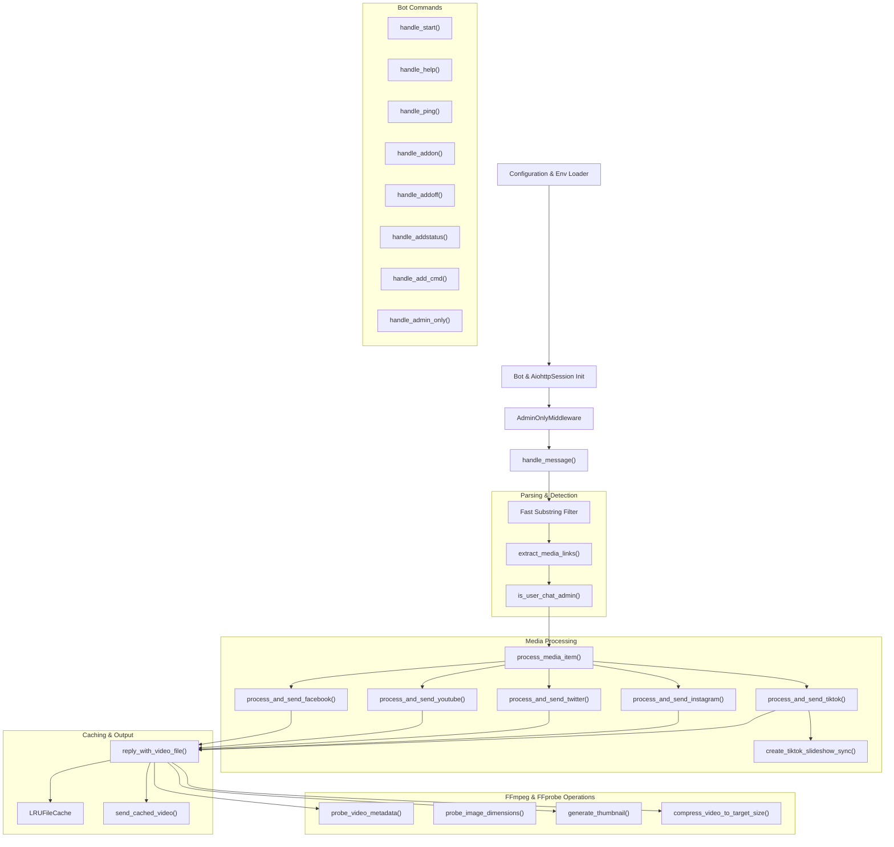
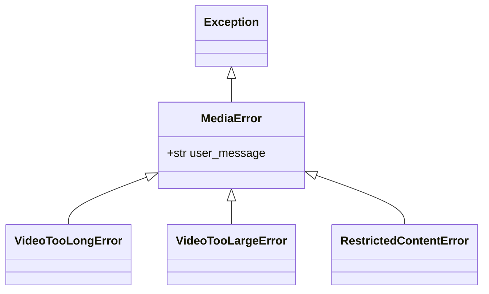

# 🧩 Relay Modules & Codebase Audit Reference

This document provides a line-by-line audit and reference guide for all components, classes, and functions implemented in [`bot.py`](../bot.py).

---

## 📑 Table of Contents

- [1. Architecture Map & Component Dependencies](#1-architecture-map--component-dependencies)
- [2. Configuration & Initialization](#2-configuration--initialization)
- [3. State Persistence & Administration](#3-state-persistence--administration)
- [4. URL Ingestion & Parsing](#4-url-ingestion--parsing)
- [5. Middleware & Event Interceptors](#5-middleware--event-interceptors)
- [6. Media Geometry & FFmpeg Engine](#6-media-geometry--ffmpeg-engine)
- [7. In-Memory LRU Cache Engine](#7-in-memory-lru-cache-engine)
- [8. Platform Downloader Subsystems](#8-platform-downloader-subsystems)
  - [TikTok Downloader & Slideshow Generator](#tiktok-downloader--slideshow-generator)
  - [Universal yt-dlp & Format Selector](#universal-yt-dlp--format-selector)
  - [Instagram Downloader](#instagram-downloader)
  - [Twitter / X Downloader](#twitter--x-downloader)
  - [YouTube Downloader](#youtube-downloader)
  - [Facebook Downloader & Redirect Resolver](#facebook-downloader--redirect-resolver)
- [9. Dispatcher & Exception Hierarchy](#9-dispatcher--exception-hierarchy)
- [10. Command Handlers](#10-command-handlers)
- [11. Message Handler & Batch Orchestration](#11-message-handler--batch-orchestration)
- [12. Background Daemons & Entry Point](#12-background-daemons--entry-point)

---

## 1. Architecture Map & Component Dependencies



---

## 2. Configuration & Initialization

### Global Variables & Environmental Constants

- `BOT_TOKEN` (`str`): Telegram bot secret token loaded from `.env`. Throws `ValueError` if missing.
- `TELEGRAM_API_SERVER` (`str | None`): Custom local Telegram Bot API Server endpoint (e.g. `http://telegram-bot-api:8081`). When provided, instantiates `AiohttpSession` using `TelegramAPIServer.from_base(TELEGRAM_API_SERVER)` with a 300-second timeout, lifting file upload limits to 2000 MB.
- `ADMIN_IDS` (`set[int]`): Parsed set of global administrator Telegram user IDs from `ADMIN_IDS` env variable.
- `SETTINGS_FILE` (`str`, default: `"settings.json"`): Path to persisted JSON configuration for bot runtime flags.
- `MAX_CONCURRENT_DOWNLOADS` (`int`, default: `3`): Concurrency semaphore limit governing heavy `yt-dlp` and `ffmpeg` tasks.
- `COOKIES_FILE` (`str`, default: `"cookies.txt"`): Path to Netscape-format cookies for authenticated extraction.
- `MAX_VIDEO_DURATION_SECONDS` (`int`, default: `900`): Maximum video duration (15 minutes).
- `MAX_FILE_SIZE_BYTES` (`int`, default: `400 * 1024 * 1024`): Direct upload ceiling (400 MB).
- `MAX_COMPRESS_SIZE_BYTES` (`int`, default: `650 * 1024 * 1024`): Threshold for automatic bitrate compression (650 MB).

---

## 3. State Persistence & Administration

### Functions

#### `load_settings() -> dict[str, Any]`
- Reads and parses `SETTINGS_FILE` (`settings.json`). Returns an empty dictionary on read or parse failure.

#### `save_settings(data: dict[str, Any]) -> None`
- Persists dictionary state to disk formatted with 2-space indentation.

#### `save_admin_only_mode(enabled: bool) -> None`
- Synchronizes the global in-memory `admin_only_mode` boolean and writes updated state to `settings.json`.

#### `is_chat_admin_only(chat_id: int) -> bool`
- Checks whether a specific group chat ID is registered in `admin_only_chats`.

#### `set_chat_admin_only(chat_id: int, enabled: bool) -> None`
- Adds or removes a `chat_id` from the `admin_only_chats` set and persists the updated configuration to `settings.json`.

#### `is_admin(user_id: int | None) -> bool`
- Returns `True` if `user_id` matches any ID defined in `ADMIN_IDS`.

#### `async get_chat_admin_ids(chat_id: int, force_refresh: bool = False) -> set[int]`
- Fetches all administrator user IDs for `chat_id` via `bot.get_chat_administrators()`.
- Caches results in `chat_admin_cache` for 5 minutes (`CHAT_ADMIN_CACHE_TTL = 300`). Supports cached fallback during network drops.

#### `async is_user_chat_admin(chat_id: int, user_id: int | None, sender_chat_id: int | None = None, force_refresh: bool = False) -> bool`
- Multi-tier administrator evaluation:
  1. Anonymous channel/group admin posts (`sender_chat_id == chat_id`): returns `True`.
  2. Global bot administrators (`is_admin(user_id)`): returns `True`.
  3. Group administrators checked against cached IDs: returns `True` if member exists.

---

## 4. URL Ingestion & Parsing

### Regular Expressions (`MEDIA_PATTERNS`)

- `TIKTOK_REGEX`: Matches `tiktok.com`, `vm.tiktok.com`, `vt.tiktok.com`, `m.tiktok.com`.
- `INSTA_REGEX`: Matches `instagram.com/(reel|reels|p|tv|share)/[id]`.
- `TWITTER_REGEX`: Matches `x.com`, `twitter.com`, `fxtwitter.com`, `vxtwitter.com`, `fixupx.com` status IDs.
- `YOUTUBE_REGEX`: Matches `youtube.com/shorts/`, `youtube.com/watch?v=`, `youtu.be/` 11-char IDs.
- `FACEBOOK_REGEX`: Matches `facebook.com/reel/`, `fb.watch/`, `facebook.com/share/`, `/videos/`.

### Functions

#### `extract_media_links(text: str) -> list[tuple[str, str, str | None]]`
- Scans arbitrary text or captions for media URLs.
- Strips trailing punctuation (`.,;:!?)]>'\"`).
- Enforces strict deduplication and overlapping offset filtering.
- Returns an ordered list of `(platform, clean_url, extra_id)`.

---

## 5. Middleware & Event Interceptors

### Class `AdminOnlyMiddleware(BaseMiddleware)`
- Intercepts all incoming `Message` events before they reach handlers.
- If `admin_only_mode` is inactive, passes the event through immediately.
- If active:
  - Global administrators pass through unconditionally.
  - In private chats: sends an HTML maintenance warning if the user attempts commands or links.
  - In group chats: drops messages silently to prevent spam.

---

## 6. Media Geometry & FFmpeg Engine

### Functions

#### `probe_video_metadata(video_path: str) -> dict[str, Any]`
- Executes `ffprobe` in JSON output mode:
  ```bash
  ffprobe -v quiet -print_format json -show_format -show_streams <path>
  ```
- Normalizes dimensions based on **Sample Aspect Ratio (SAR)**:
  $$\text{Display Width} = \text{round}\left(\text{Pixel Width} \times \frac{\text{SAR}_\text{num}}{\text{SAR}_\text{den}}\right)$$
- Handles 90° and 270° smartphone camera orientation tags (`rotate`), swapping width and height to prevent squished playback.

#### `generate_thumbnail(video_path: str, thumb_path: str, width: int | None, height: int | None) -> bool`
- Captures an accurate frame at 1.0s (or 0.0s for short clips):
  ```bash
  ffmpeg -y -ss <seek_time> -i <video> -vframes 1 -vf scale='if(gt(iw,ih),320,-2)':'if(gt(iw,ih),-2,320)' -q:v 3 <thumb>
  ```
- Constrains the longest side to 320px while maintaining the exact aspect ratio.

#### `compress_video_to_target_size(input_path: str, output_path: str, duration: int, target_size_mb: int = 380) -> bool`
- Computes optimal single-pass bitrate:
  $$\text{Total Bitrate} = \frac{\text{Target MB} \times 1024 \times 1024 \times 8}{\text{Duration}}$$
- Encodes with `libx264` (`-preset veryfast`), `aac` (`96k`), and `-movflags +faststart`.
- Validates output file size against $\text{target\_size\_mb} \times 1.05$.

#### `async reply_with_video_file(message: Message, original_url: str, file_path: str) -> bool`
- Master delivery handler:
  1. Validates video stream presence.
  2. Enforces `MAX_VIDEO_DURATION_SECONDS` (15 minutes).
  3. Enforces `MAX_FILE_SIZE_BYTES` (400 MB). Triggers auto-compression if file is $\le 650 \text{ MB}$.
  4. Generates proportional thumbnail.
  5. Uploads via `message.reply_video()` with `supports_streaming=True`.
  6. Stores generated Telegram `file_id` in `LRUFileCache`.
  7. Cleans up temporary thumbnail and compressed files in `finally` blocks.

---

## 7. In-Memory LRU Cache Engine

### Classes

#### `dataclass CachedVideo`
- Attributes: `file_id: str`, `width: int | None`, `height: int | None`, `duration: int | None`.

#### `class LRUFileCache`
- Thread-safe `OrderedDict` with `asyncio.Lock` protection (default capacity: 1,000 items).
- `get(url) -> CachedVideo | None`: Retrieves cached video metadata and bumps key to most recently used.
- `set(url, cached_video) -> None`: Inserts or updates cache, evicting the oldest entry if size exceeds capacity.

#### `async send_cached_video(message: Message, cached: CachedVideo) -> bool`
- Instantly transmits a video using its cached `file_id` without downloading or re-encoding.

---

## 8. Platform Downloader Subsystems

### TikTok Downloader & Slideshow Generator

- `probe_image_dimensions(image_path: str) -> tuple[int, int]`: Uses `ffprobe` to determine image dimensions, falling back to 1080x1920.
- `create_tiktok_slideshow_sync(image_paths, audio_path, output_path) -> bool`:
  - Builds dynamic slide durations (2.0s to 4.0s).
  - Pads and scales images into uniform 1080p canvas with black letterboxing.
  - Concat filter merges video streams; audio track loops with 0.5s fadeout.
- `extract_tiktok_data(url: str) -> dict | None`: Queries TikWM JSON endpoint.
- `process_and_send_tiktok(message: Message, url: str) -> bool`: Handles slideshow photo-posts, direct HD video downloads, and `yt-dlp` fallback.

### Universal yt-dlp & Format Selector

- `check_restricted_content_error(e: Exception, platform_name: str) -> None`: Inspects exception messages for 18+, age restrictions, login requirements, and private account walls, raising `RestrictedContentError`.
- `probe_ytdlp_metadata(url: str, extractor_args: dict | None, platform_name: str) -> dict | None`: Pre-extracts info without downloading to validate duration and approximate file size.
- `download_ytdlp_sync(url: str, extractor_args: dict | None, platform_name: str) -> str | None`:
  - Pre-flight metadata inspection.
  - Multi-tier format selector prioritizing H.264/AVC + AAC MP4 streams under 400 MB.
  - Passes `-movflags +faststart` to merger and video converter.

### Instagram Downloader
- `download_instagram_sync(url: str)`: Calls `yt-dlp` with `extractor_args={"instagram": {"skip": ["comments"]}}` and `cookies.txt`.
- `process_and_send_instagram(message: Message, url: str) -> bool`: Acquires semaphore, executes download, dispatches to `reply_with_video_file`.

### Twitter / X Downloader
- `extract_twitter_url(tweet_id: str) -> str | None`: Queries FxTwitter API v2 and selects highest bitrate MP4.
- `process_and_send_twitter(message: Message, url: str, tweet_id: str) -> bool`: Fast-path streaming via `aiohttp` chunked transfer; falls back to `yt-dlp`.

### YouTube Downloader
- `download_youtube_sync(url: str) -> str | None`: Downloads YouTube Shorts, Clips, or regular videos via `yt-dlp`.
- `process_and_send_youtube(message: Message, url: str) -> bool`: Executes download and transmits video.

### Facebook Downloader & Redirect Resolver
- `resolve_facebook_url(url: str) -> str`: Resolves 301/302 redirects for `fb.watch` and `/share/` short links.
- `process_and_send_facebook(message: Message, url: str) -> bool`: Checks cache for both raw and resolved URLs; executes download with retry fallbacks.

---

## 9. Dispatcher & Exception Hierarchy

### Exception Hierarchy



- `MediaError`: Base class containing user-friendly error messages in Ukrainian.
- `VideoTooLongError`: Raised when duration exceeds 15 minutes.
- `VideoTooLargeError`: Raised when file exceeds 400 MB (or 650 MB after compression attempts).
- `RestrictedContentError`: Raised on age restrictions, private content, or login walls.

### `process_media_item(message, platform, url, extra) -> bool`
- Routes URL to platform-specific handler.
- Catches `MediaError` exceptions and sends user-facing notifications into the chat.
- Catches and logs unhandled exceptions without crashing the bot.

---

## 10. Command Handlers

| Command | Aliases | Access Level | Description |
| :--- | :--- | :--- | :--- |
| `/start` | - | Public | Welcome banner and supported platforms overview. |
| `/help` | - | Public | Usage guidelines, group instructions, and active limits. |
| `/ping` | - | Public | Diagnostic ping showing User ID, Global Admin mode, and Group mode. |
| `/addon` | `/adminon`, `/add_on`, `/admin_on` | Group Admin | Restricts group downloading exclusively to group admins. |
| `/addoff` | `/adminoff`, `/add_off`, `/admin_off` | Group Admin | Restores open downloading for all group members. |
| `/addstatus` | `/adminstatus`, `/add_status` | Group Admin / Members | Displays current `/addon` restriction status for the group. |
| `/add [on\|off\|status]` | - | Group Admin | Unified multi-purpose switch or toggle for group mode. |
| `/adminonly [on\|off\|status]` | `/maintenance` | Bot Admin (`ADMIN_IDS`) | Global maintenance mode switch. Persisted in `settings.json`. |

---

## 11. Message Handler & Batch Orchestration

### `handle_message(message: Message)`
1. **Fast-Path Check**: Performs raw substring search for media domains (`tiktok.com`, `instagram.com`, `twitter.com`, `x.com`, `youtube.com`, `fb.watch`, etc.). Exits immediately if no domains match.
2. **URL Extraction**: Calls `extract_media_links(text)`.
3. **Group Moderation**: Verifies `/addon` permissions via `is_user_chat_admin()`. Drops requests from non-admins if restricted.
4. **Batch Concurrency**: Caps URLs at 5 per message and dispatches concurrently via `asyncio.gather(*tasks, return_exceptions=True)`.
5. **Clean Chat Deletion**: In group chats where at least one video succeeded, attempts `message.delete()` if granted admin rights. Never deletes in private chats.

---

## 12. Background Daemons & Entry Point

### `periodic_temp_cleaner()`
- Runs continuously as an `asyncio.Task` every 30 minutes (1,800 seconds).
- Inspects `tempfile.gettempdir()`.
- Purges orphaned directories starting with `"tmp"` and media files (`.mp4`, `.jpg`, `.part`, `.ytdl`) older than 30 minutes.

### `main()`
- Configures logging and suppresses noisy `aiogram.event` logs.
- Loads `ADMIN_IDS` and displays startup warnings if admin mode is active.
- Initializes shared `aiohttp.ClientSession` with connection pooling (pool limit: 50, keepalive: 60s).
- Spawns `periodic_temp_cleaner` background task.
- Initiates Telegram polling: `dp.start_polling(bot, allowed_updates=["message"], polling_timeout=20)`.
- Ensures clean shutdown of HTTP session and background cleaner on SIGINT/SIGTERM.
